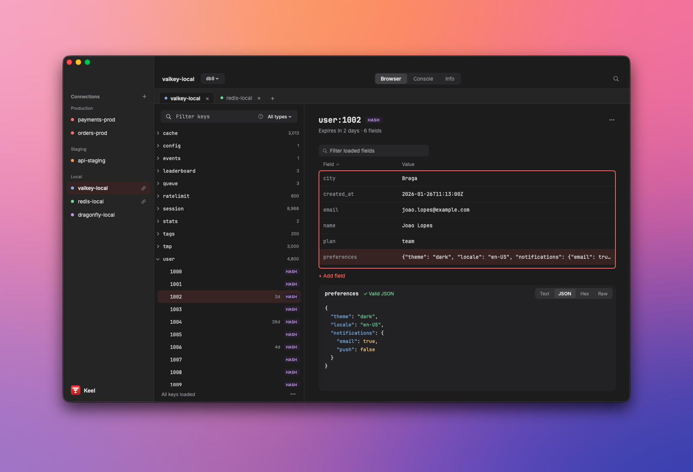

# Keel

[](https://github.com/bearstouch/keel/actions/workflows/ci.yml)

A calm, native client for Redis, Valkey and Dragonfly on macOS by Bearstouch. Keel browses millions of keys with
SCAN only, edits every core type, has a redis-cli-style console and a server overview, keeps production safe with
read-only connections and typed confirmations.



| Server | Versions | Support |
| --- | --- | --- |
| Redis | 6.0+ | Full |
| Valkey | 7.2 – 9.x | Full, first-class |
| Dragonfly | 1.x | Common command set; capability probes cover differences |

Requires macOS 14 or later. See [Integrations](docs/integrations.md) for details.

> **Status:** v1 in release qualification; see [Project status](docs/project/status.md).

## Features

- **Connections:** profiles in folders with color labels, ACL users, TLS (custom CA, client certificate) and SSH
  tunnels through `/usr/bin/ssh` with saved hosts and `~/.ssh/config` discovery. Paste a `redis://` URL,
  test before saving, export and import profiles without secrets.
- **Key browser:** SCAN only, never `KEYS`. Tree and flat views stay smooth with millions of keys, with pattern and type
  filters, TTL and type badges, on-demand memory size and a database switcher.
- **Editors:** string, hash, list, set, sorted set and stream, with Text, JSON, Hex and Raw viewers. Values load in
  bounded pages; keys and values are byte strings end to end, so binary data round-trips exactly. Multi-step edits run
  in `MULTI/EXEC` guarded by `WATCH`, and unsaved changes are never dropped silently.
- **Console:** redis-cli-style output, history, command-name completion with inline argument hints, RESP2 or RESP3.
- **Info:** a server overview (memory, clients, operations per second, uptime, keys per database, replication, last
  save and hit ratio), with every `INFO` section and a searchable raw view on demand.
- **Production safety:** read-only connections block every write, script and admin command (fail closed). Multi-key
  delete, bulk delete, `FLUSHDB` and `FLUSHALL` need a typed confirmation; bulk delete by pattern runs SCAN + UNLINK in
  batches with progress and cancel. Production tabs carry a maroon "Production · Read-only" strip.
- **Keyboard:** command palette (⌘K) over actions, connections, tabs, databases and recent keys; rebindable shortcuts.
- **Look:** light, dark or system theme, Inter for the interface and JetBrains Mono for keys, values and the console;
  VoiceOver labels throughout.
- **Updates:** **Keel → Check for Updates…** installs signed Sparkle updates after you confirm. The daily check can be
  turned off in Settings → General.
- **Privacy:** no telemetry. Values, key names and console text are never logged or saved; passwords live only in the
  Keychain. The only network traffic is to the servers and SSH hosts you configure, and the update feed.

See the [functional requirements](docs/requirements/functional.md) for the full behavior.

## Quick start

```sh
git clone https://github.com/bearstouch/keel.git
cd keel
swift build
swift run Keel --state-directory "$PWD/.build/dev-state"
```

Development builds use the bundle ID `com.bearstouch.keel.dev`, so they never touch an installed Keel's
`~/Library/Application Support/com.bearstouch.keel/`. `--state-directory` also keeps your hacking profiles apart from
your everyday development ones. Saved passwords go to the same Keychain items in every run; use `--fixture` to keep
them in memory.

## Development setup

### Prerequisites

| Requirement | Version | Notes |
| --- | --- | --- |
| macOS | 14 Sonoma or later | Development is done on recent macOS on Apple silicon |
| Xcode | 26 | Provides Swift 6.2 and `swift format`. CI and releases pin 26.0.1 (see [Troubleshooting](#troubleshooting)). Run `sudo xcode-select -s /Applications/Xcode.app` if `xcode-select -p` points at the Command Line Tools |
| Python 3 | System | Generators, integration matrix and benchmarks |
| Docker or Colima | Optional | Only for the container integration matrix |
| `redis-server` / `redis-cli` | Optional, 7.x | Only for benchmarks and console goldens |
| `librsvg` | Optional | `brew install librsvg`, only to regenerate the app icon |

Check your toolchain:

```sh
swift --version        # Apple Swift version 6.2 or later
swift format --version
```

You don't need an Apple Developer account. Sparkle 2 is the only external package, pinned to an exact version; the
code shared with Trellis is vendored under `ThirdParty/TrellisShared`.

### Editors

- **Xcode:** `open Package.swift`. Choose the `Keel` scheme to run the app and `Keel-Package` to run tests. To pass
  launch arguments such as `--state-directory /abs/path`, edit the scheme (Product → Scheme → Edit Scheme… → Arguments).
- **VS Code / Cursor:** install the [Swift extension](https://marketplace.visualstudio.com/items?itemName=swiftlang.swift-vscode).
  It reads `Package.swift` directly and uses SourceKit-LSP.

### Everyday commands

```sh
swift build                                    # build (must stay warning-free)
swift test                                     # full XCTest suite
swift test --filter KeelCoreTests.SafetyPolicyTests   # one test class
swift format -i -r Sources Tests ThirdParty               # format in place
swift format lint --strict -r Sources Tests ThirdParty    # lint: must print nothing
```

Before every commit, run this one-liner:

```sh
swift format -i -r Sources Tests ThirdParty && swift format lint --strict -r Sources Tests ThirdParty && swift build && swift test
```

Formatting uses the toolchain's `swift format` with the repo [`.swift-format`](.swift-format) (4-space indent, 220
columns). `swift format` skips symlinks, so name `ThirdParty` explicitly. The repo has no SwiftLint or SwiftFormat
dependency.

### Running the app

| Command | What it does |
| --- | --- |
| `swift run Keel` | Runs with the development state folder for `com.bearstouch.keel.dev` |
| `swift run Keel --state-directory /abs/path` | Uses a separate state folder (created owner-only). Saved passwords still use the shared Keychain items |
| `swift run Keel --fixture` | Starts with a fresh temporary state folder; passwords stay in memory and the Keychain is never read or written |

An unknown `--` flag exits with status 64, an unusable state folder (a file, a symlink or another user's folder) with
73, and a second launch against a state folder already in use brings the running Keel forward and exits with 75. See
[Getting started](docs/development/getting-started.md#launch-arguments-and-state).

Never point Keel's tests at your own servers: protocol code is tested against in-memory fake servers, and the
integration tests run pinned containers.

### Other scripts

```sh
python3 -I scripts/integration-matrix.py [--servers redis-7.4,valkey-9.x]   # pinned Redis/Valkey/Dragonfly containers (Docker); evidence in .build/integration/
python3 scripts/bench-browser.py [--quick] --redis-server "$(which redis-server)"   # 1M/10M-key benchmarks; evidence in .build/bench/
python3 -I scripts/generate-command-catalog.py --redis DIR VER --valkey DIR VER --check DIR VER   # bundled command catalog
python3 -I scripts/generate-design-tokens.py [--check]   # design-token fixture from docs/design/index.md
python3 -I scripts/capture-console-goldens.py --redis-server PATH --redis-cli PATH   # console goldens
scripts/generate-app-icon.sh [--check]       # app icon assets from keel-icon.svg (needs rsvg-convert)
scripts/package-release.sh                    # Universal 2 app, DMG and release evidence in dist/ (ad-hoc unless KEEL_SIGN_IDENTITY / KEEL_NOTARY_PROFILE)
```

### CI and releases

- [`ci.yml`](.github/workflows/ci.yml) runs lint, build (no warnings in `Sources/`) and the full test suite on
  `macos-26` with Xcode 26.0.1, plus the container integration matrix. It runs for every pull request to `master` or
  `develop`, for every push to those branches, and can be started by hand.
- [`release.yml`](.github/workflows/release.yml) runs when you push a tag `vX.Y.Z` that matches
  `release/manifest.json`. It tests, benchmarks, packages the Universal 2 DMG and Sparkle archive, and publishes a
  GitHub release whose notes come from the matching `CHANGELOG.md` section. Without signing secrets the build is ad-hoc
  signed and published as a pre-release; the secrets it uses are listed at the top of the workflow. A manual run builds
  the artifacts without publishing.

To cut a release, bump `release/manifest.json` and both versions in `release/Info.plist`, add the `CHANGELOG.md`
section, commit, then run `git tag vX.Y.Z && git push --tags`. Signing, notarization, Sparkle keys and the appcast are
described in [release/README.md](release/README.md) and [Releasing](docs/development/releasing.md).

## Documentation

The [`docs/`](docs/index.md) folder is the behavior contract and contributor guide. It's plain Markdown, laid out for
[MkDocs Material](https://squidfunk.github.io/mkdocs-material/):

```sh
python3 -m venv .venv-docs && .venv-docs/bin/pip install mkdocs-material
.venv-docs/bin/mkdocs serve    # http://127.0.0.1:8000
```

Good starting points:

- [Product overview](docs/overview.md) and [Architecture](docs/architecture.md)
- [Requirements](docs/requirements/index.md): the behavior contract, with stable requirement IDs
- [Integrations](docs/integrations.md), [macOS support](docs/macos.md) and [Design](docs/design/index.md)
- [API reference](docs/api/index.md) for each module
- [Development](docs/development/getting-started.md): rules, testing, change workflow and releasing
- [CONTRIBUTING.md](CONTRIBUTING.md): the rules contributors must follow, and [CLAUDE.md](CLAUDE.md): agent guidance

## Troubleshooting

- **`swift format` not found:** `xcode-select -p` points at the Command Line Tools. Switch it to Xcode 26.
- **Concurrency errors on build:** you're on an older toolchain. The package requires Swift 6.2 in Swift 6 language
  mode.
- **Tests abort with "freed pointer was not the last allocation":** builds from Xcode 26.3 and later miscompile a
  persistence debounce task. Build with Xcode 26.0.1, as CI does (see [Known gaps](docs/project/status.md#known-gaps)).
- **The app exits with status 64, 73 or 75:** an unknown flag (or a single-dash `-fixture`), an unusable state folder,
  or another Keel already holding that state folder. `--state-directory` needs an absolute path.
- **A LAN server times out on macOS 15 or later:** Keel needs the Local Network permission. Allow it in System
  Settings → Privacy & Security → Local Network.
- **The ad-hoc `.app` is blocked by Gatekeeper when copied to another Mac:** this is expected. Only Developer ID–signed,
  notarized builds can be distributed.

## Contributing

Contributions are welcome. Read [CONTRIBUTING.md](CONTRIBUTING.md) for the workflow, code style, test conventions and
how to report security issues.

## License

Keel is released under the [MIT License](LICENSE). Bundled third-party components keep their own licenses: Sparkle
(MIT) and the Inter and JetBrains Mono fonts (SIL Open Font License 1.1).
