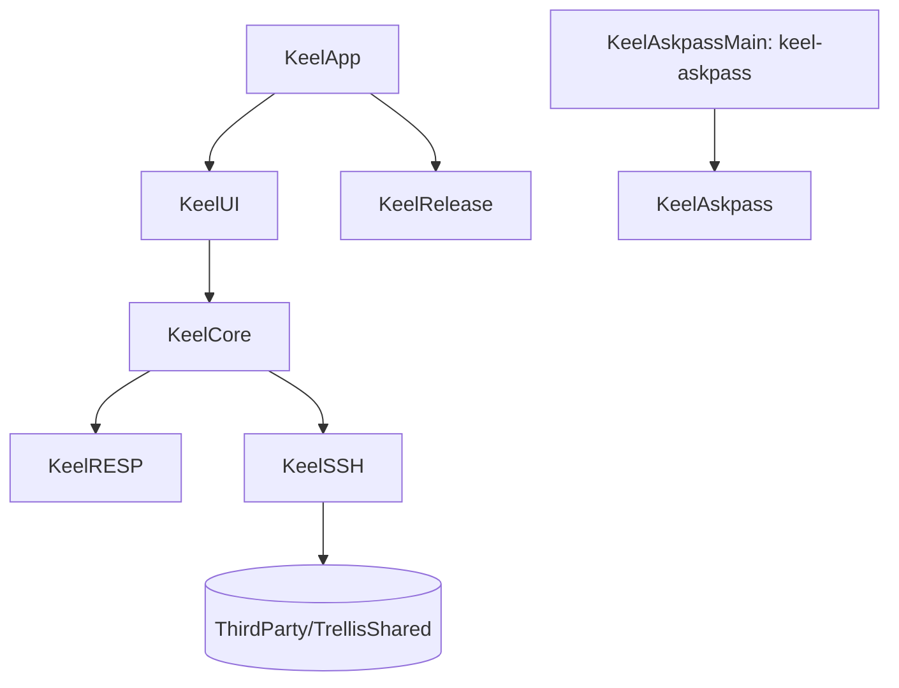

# API reference

Keel's modules are SwiftPM targets with `public` APIs across module boundaries. These pages describe the public
types a contributor works with: what they do, how they are isolated, and the invariants they keep. The source is the
final word on signatures; behavior is specified in [Architecture](../architecture.md) and the
[requirements](../requirements/index.md).

| Module | Role | Page |
| --- | --- | --- |
| `KeelRESP` | RESP2/RESP3 codec, `RedisConnection` actor over Network.framework, handshake, TLS | [KeelRESP](resp.md) |
| `KeelSSH`, `KeelAskpass`, `KeelAskpassMain` | OpenSSH tunnels, SSH host library, askpass broker and helper | [KeelSSH](ssh.md) |
| `KeelCore` | Domain: data path, safety policy, command catalog, sessions, profiles, persistence, key index, editors, console | [KeelCore](core.md) |
| `KeelUI` | SwiftUI and AppKit views, `@MainActor` view models, design tokens | [KeelUI](ui.md) |
| `KeelRelease`, `KeelApp` | Release manifest, update policy, data removal; the `@main` entry point | [KeelRelease and KeelApp](release.md) |

## Conventions

- **Isolation.** Stores, sessions, connections, persistence and job runners are actors. UI-facing classes are
  `@MainActor`. Core value types are `Sendable` and usually `Equatable`.
- **Errors.** Failures carry a SCREAMING_SNAKE code shared across modules; see
  [Architecture → Errors](../architecture.md#errors).
- **Bytes.** Keys, values and arguments are byte strings (`[UInt8]`/`Data`), never decoded strings.
- **Injection.** Time, the filesystem, the Keychain, processes and transports are parameters, so every module can be
  tested with fakes ([Testing](../development/testing.md)).
