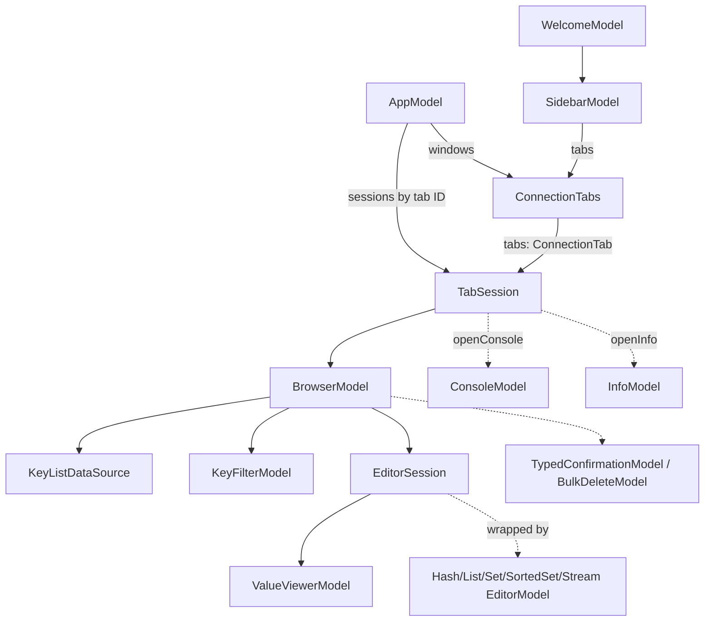

# KeelUI

`KeelUI` is the app's interface layer: SwiftUI chrome (sidebar, toolbar, tab bar, editors, sheets, Info, Settings)
plus AppKit where SwiftUI does not scale — `NSOutlineView` / `NSTableView` for key lists with millions of rows, an
`NSTextView` for the console and the value viewer, an `NSTableView` for the hex view. Every view model is a
`@MainActor` `ObservableObject`; network I/O, parsing, SCAN accumulation and tree building happen in KeelCore actors
(see [Threading](../architecture.md#threading)). No view or view model owns a `RedisConnection`: every command goes
through KeelCore's `DataCommandService` and `SafetyPolicy` ([One data path](../architecture.md#one-data-path)). The
target depends on `KeelCore` and `KeelSSH` (prompt relay, host library) — `KeelRESP` reply types arrive through
KeelCore — and nothing in `KeelApp`, so windows and models can be built and tested without launching the app.

Behavior is specified in [functional requirements](../requirements/functional.md); visuals in the
[design contract](../design/index.md). Requirement IDs quoted below (`FR-`, `NFR-`, `DS-`, `MAC-`) are defined in the [requirements](../requirements/index.md).

## Model hierarchy

`AppModel` owns every window's tabs (`ConnectionTabs`) and every tab's live session (`TabSession`), keyed by tab ID.
A session belongs to the tab, not the window, so dragging a tab to another window keeps it connected. Once connected,
a session creates its `BrowserModel`; `ConsoleModel` and `InfoModel` are created lazily the first time the tab shows
that mode. The browser holds one `EditorSession` for the open key; a type editor model wraps that session.



Per window, the app delegate (KeelApp) wires a `SidebarModel` over that window's `ConnectionTabs`, plus the shared
`ConnectionSheetPresenter`, `ProfileTransferModel`, `SSHPromptCenter` and a per-window `CommandPaletteModel`, and hands
them to `MainWindow.make`. `SettingsModel` and `ShortcutBindings` are app-wide singletons owned by the app delegate.

## App and windows

### AppModel

`@MainActor final class`, `ObservableObject`. Restores and saves `windows.json` (via `Persistence<WindowsDocument>`),
connects tabs the sidebar opens, moves tabs between windows with their sessions, asks before closing a tab with
unsaved edits, and keeps the in-memory recent-keys list for the palette (never persisted). Tabs restore disconnected
unless their profile reconnects on launch; production profiles never auto-reconnect.

```swift
public init(profiles: ProfileStore, connector: any SessionConnecting, persistence: Persistence<WindowsDocument>?, settings: SettingsSnapshot = SettingsSnapshot())
@Published public private(set) var windows: [ConnectionTabs]
@Published public private(set) var recentProfileIDs: [UUID]          // welcome screen recents
public private(set) var sessions: [UUID: TabSession]
@Published public var sheetWindowID: UUID?                            // the one window presenting app-wide sheets
public var presentWindow: ((ConnectionTabs) -> Void)?                 // set by the app delegate
public var focusWindow: ((UUID) -> Void)?

public func restore(reopens: Bool = true) async -> [(window: ConnectionTabs, frame: SavedFrame?)]
public func newWindow() -> ConnectionTabs
public func closeWindow(_ id: UUID)
public func moveTab(_ tabID: UUID, to target: ConnectionTabs, at index: Int? = nil)
public func moveTabToNewWindow(_ tabID: UUID) -> ConnectionTabs?
public func requestClose(_ tabID: UUID, discardingEdits: Bool = false) -> CloseRequest   // .closed | .needsConfirmation
public func session(_ tabID: UUID) -> TabSession?
public func connectIfNeeded(_ tabID: UUID)
public func reconnect(_ tabID: UUID) async
public func disconnect(profileID: UUID) async
public func status(ofProfile profileID: UUID) -> ConnectionStatus
public func flush() async                                             // write pending windows.json at quit
```

`restore` never writes over a `windows.json` that needs recovery; saving is off until a successful read.

### ConnectionTabs, ConnectionTab, ConnectionStatus

`ConnectionTabs` is a `@MainActor final class` (`ObservableObject`, `Identifiable`): one window's tab strip.
`ConnectionTab` is a `Sendable` value (`id`, `profileID`, `database`, `mode: TabMode`, `status`) convertible to and
from KeelCore's `SavedTab`. `ConnectionStatus` is `disconnected | connecting | connected | failed` with a `spoken`
form for VoiceOver.

```swift
@Published public private(set) var tabs: [ConnectionTab]
@Published public var selectedID: ConnectionTab.ID?
@Published public var showsConnectionPicker: Bool
@Published public var confirmingCloseTabID: ConnectionTab.ID?
public var selected: ConnectionTab?
public func open(profileID: UUID, database: Int, newTab: Bool = false) -> ConnectionTab
public func close(_ id: ConnectionTab.ID)
public func setMode(_ mode: TabMode)
public func selectTab(offset: Int)
```

### TabSession

`@MainActor final class`. One tab's live connection: connect / reconnect / disconnect through a `SessionConnecting`
(KeelCore), the connected `ServerIdentity`, and the per-mode models. A connect counter (`attempt`) drops results of
superseded connects and closes their connections. It tracks the production write notice (FR-SF07: first sent write
on a writable production tab), server-enforced read-only (a server refusal), and live read-only locking when the
profile changes.

```swift
@Published public private(set) var status: ConnectionStatus
@Published public private(set) var failure: ConnectionFailure?
@Published public private(set) var server: ServerIdentity?
@Published public private(set) var browser: BrowserModel?
@Published public private(set) var console: ConsoleModel?
@Published public private(set) var info: InfoModel?
@Published public var hasUnsavedEdits: Bool              // mirrors the open editor's changedRows
@Published public private(set) var writesBlocked: Bool?  // nil while disconnected
@Published public private(set) var serverReadOnly: Bool
@Published public private(set) var showsProductionWriteNotice: Bool
public func connect(database: Int) async
public func reveal(_ key: Data, database: Int) async
public func disconnect() async
public func openConsole()
public func openInfo(browse: @escaping (Int) -> Void)
```

The browser is built in `TabSession.browser(for:database:settings:)`: a `KeyIndex` over the session's
`DataCommandService`, a `KeyListDataSource` with a `RowMetadataLoader`, a `KeyFilterModel`, and
`EditorBinding.editor(for:)` (KeelCore) as the per-type editor factory.

### MainWindow, RootView, window content

| Type | Kind | Purpose |
| --- | --- | --- |
| `MainWindow` | `@MainActor enum` | `make(prompts:connections:sidebar:transfer:palette:) -> NSWindow` builds the full-size-content window (min 720 x 480) hosting `RootView`; `constrained(_:to:)` places a saved frame on current displays (MAC-05). |
| `RootView` | `public struct View` | Sidebar beside the detail (toolbar, tab bar, tab content) or the welcome screen; attaches the palette overlay and the connection, transfer and SSH prompt sheets. Sets Inter 13 as the default font outermost. All inputs optional for previews and tests. |
| `WindowContent`, `ConnectionToolbar`, `TabBar`, `ModeSwitch`, `TabContent` | internal views (`WindowView.swift`) | 52 px toolbar with the db picker and Browser / Console / Info switch; 38 px tab bar with drag between windows (`TabDragItem`); the selected tab's content or its connect state. |
| `ProductionStrip`, `ProductionWriteNotice` | internal views | Maroon strip with text under the tab bar; the one-time "Writing to PRODUCTION" line. |

### WelcomeView / WelcomeModel

`WelcomeModel` (`@MainActor`) backs the screen of a window with no tabs (FR-AP08): up to `recentLimit` (5) recent
connections from `AppModel.recentProfileIDs` with the sidebar's current names, plus New Connection, Paste URL
(clipboard reader injected) and Import.

```swift
public init(sidebar: SidebarModel, connections: ConnectionSheetPresenter? = nil, transfer: ProfileTransferModel? = nil, readClipboard: @escaping @MainActor () -> String? = ...)
public var recents: [Recent]
public func open(_ profileID: UUID)
public func newConnection(); public func pasteURL(); public func importConnections()
```

## Sidebar and connection sheet

### SidebarModel / SidebarView

`SidebarModel` (`@MainActor`) follows `ProfileStore` changes and presents profiles grouped by folder (`groups`,
`visibleRows`), with statuses taken from the window's tabs. It handles open (optionally new tab), keyboard selection,
rename, duplicate, delete, folder CRUD, drag-and-drop reordering (`DragItem` payloads) and Copy URL (pasteboard
writer injected). It also derives `windowTitle` and `productionStrip` text. `SidebarView` is the SwiftUI list,
including the `KeelMark` drawn from the icon geometry.

```swift
public init(store: ProfileStore, tabs: ConnectionTabs, sheets: ConnectionSheetPresenter? = nil, copy: @escaping @MainActor (String) -> Void = ...)
public func start()
public var groups: [Group]
public func open(_ profileID: UUID, newTab: Bool = false)
public func move(_ profileID: UUID, toFolder folderID: UUID?, before beforeID: UUID? = nil) async
public func drop(_ payloads: [String], into folderID: UUID?, beforeProfile: UUID? = nil) async -> Bool
public nonisolated static func accessibilityLabel(name: String, labelName: String?, status: ConnectionStatus) -> String
```

### ConnectionSheetModel, ConnectionSheetPresenter, ConnectionSheet

- `ConnectionSheetModel` (`@MainActor`): the New / Edit Connection form (FR-CN19) as published strings — URL paste,
  host, port, auth, label, read-only, TLS, SSH tunnel (`TunnelKind`), advanced fields. `settings()` validates into a
  KeelCore `ConnectionSettings` (throws `ProfileStoreError`); `invalidField` / `canSave` drive the Save button;
  `test()` runs a `ConnectionTesting`; turning read-only off on a production label asks first
  (`confirmingWritableProduction`). Saving goes through the `ProfileSaving` protocol (`ProfileStore` conforms);
  connection-affecting edits flag `savedPasswordWillBeRemoved`. The finished state is `outcome`.
- `ConnectionSheetPresenter` (`@MainActor`): builds one model at a time (`newConnection(folderID:)`,
  `newConnection(pastingURL:)`, `edit(_:)`) and exposes `model` for the `.connectionSheet(_:)` view modifier.
- `ConnectionSheet` (`public struct View`): the sheet itself; `SheetTextField`, `FieldStyle` and `SheetButtonStyle`
  are the shared sheet controls (visible label is the accessibility label).

### HostPickerModel, HostEditorModel

`HostPickerModel` (`@MainActor`) lists saved SSH hosts from KeelSSH's `HostLibrary` plus aliases discovered in
`~/.ssh/config` (injectable `Discover` closure), with notes for unfollowed `Include`s. `choose(_:)` turns a discovered
alias into a saved host. `HostEditorModel` is the Add / Edit SSH Host sheet's form, with a write-only password and
`requiresUserPresence`; `connectionChanged` (edit only) is true when the typed destination, user, port or identity
file connect elsewhere, and the sheet then warns that the saved passwords of the host and its connections go (FR-CN21). Views: `HostPickerSection`, `HostEditorSheet`.

### SSHPromptCenter / SSHPromptSheet

`SSHPromptCenter` (`@MainActor`) attaches to KeelSSH's `PromptRelay` and queues every non-password ssh prompt
(host-key confirmation and others) for the user; `respond(to:with:)` answers the prompt with that ID (the one the sheet showed) and drops an answer for a prompt no
longer queued. `SSHPromptSheet` shows
`current`; apply with `.sshPrompts(_:)`. Nothing is auto-accepted.

### ProfileTransferModel

`@MainActor`. Export / Import Connections (FR-CN14): file panels, reader and writer are injected; reads are capped
(`readCapped`). `beginImport()` produces a `PendingImport` preview; `policy` picks `ProfileImportPolicy`;
`confirmImport()` applies it. Attach with `.profileTransfer(_:)`.

## Key browser

### BrowserModel

`@MainActor final class`. A connected tab's browser: the database list and switcher, the key list and filter, the
open `EditorSession`, delete flows and New Key. Menu commands arrive as notifications (`KeyListCommands`,
`EditorCommands`) posted with the key window; each browser acts only when its list is in that window.

```swift
public init(list: KeyListDataSource, filter: KeyFilterModel? = nil, database: Int, serverMode: ServerMode = .standalone, databaseCount: Int? = nil,
            startScan: @escaping @MainActor (KeyIndex) async -> Void = { _ = await $0.loadMore() },
            editorBinding: @escaping @MainActor (KeyType) -> EditorBinding? = { _ in nil }, defaultViewer: ValueViewMode? = nil)
@Published public private(set) var databases: DatabaseList
@Published public private(set) var database: Int
@Published public private(set) var editor: EditorSession?
@Published public private(set) var isReadOnly: Bool
@Published public private(set) var missingKey: Data?          // selected key gone from the server
@Published public var deleteConfirmation: TypedConfirmationModel?
@Published public var bulkDelete: BulkDeleteModel?
@Published public var showsNewKey: Bool
public func start() async
public func refresh() async
public func selectDatabase(_ database: Int) async
public func reveal(_ key: Data) async
public func requestDeleteSelection() async                    // typed confirmation for multi-key delete
public func requestBulkDelete() async
public func createKey(_ key: Data, _ value: NewKey.Value, ttlMilliseconds: Int64?) async -> String?
```

`BrowserPane` and `DatabasePicker` are the public views over it; `MissingKeyNotice` is internal.

### KeyListDataSource and the AppKit lists

`KeyListDataSource` (`@MainActor final class`, `NSObject`, `ObservableObject`) drives a `KeyListOutlineView` (tree
mode) and a `KeyListTableView` (flat mode) over one KeelCore `KeyIndex`, and is their data source, delegate and
context-menu delegate. Both views are view-based and ask only for visible rows; row content is fetched from the index
in batches for the visible range plus a margin and cached (NFR performance: a million keys never become a million
strings). Tree items (`KeyListItem`) are created lazily per child. Selection is a key, not a row, so toggling modes
(⇧⌘T) keeps it.

```swift
public init(index: KeyIndex, mode: Mode = .tree, metadataLoader: RowMetadataLoader? = nil)
public let outlineView: KeyListOutlineView, tableView: KeyListTableView, scrollView: NSScrollView
@Published public private(set) var mode: Mode                  // .tree | .flat
@Published public private(set) var selectedKey: Int?
@Published public private(set) var selectedKeys: [Int]
@Published public private(set) var footer: KeyIndexFooter
public func reload() async
public func select(keyBytes: Data?) async
public func selectedKeyName() async -> Data?                   // bytes, never the display string
public func setLocalFilter(_ text: String) async
public func setMode(_ mode: Mode) async
public func setShowsSizes(_ on: Bool) async
```

`KeyListOutlineView` / `KeyListTableView` override `keyDown` (⌫ deletes through the owner) and draw an inset focus
ring (`KeyListFocus`). `KeyListCellView`, `KeyListBadge` and `KeyListRowView` are internal AppKit cells using
`Tokens.NS`. `KeyListPane` (public SwiftUI) hosts the scroll view via `KeyListHost` (`NSViewRepresentable`) with the
filter bar and footer.

`KeyListCommands` and `EditorCommands` hold the notification names (`refreshNotification`, `newKeyNotification`,
`deleteNotification`, `selectDatabaseNotification` + `databaseKey`, `focusFilterNotification`, `saveNotification`,
`revertNotification`, `renameNotification`, `setTTLNotification`) and the `toggleMode` selector the menus use.

### KeyListRow

`public struct`, `Equatable`, `Sendable`. A presentable row: escaped `name`, folder `keyCount`, `type`, TTL and size
strings, `badge`, `meta`, and an `accessibilityLabel`. `presented(at:showsSizes:)` re-formats TTL against a clock.

### KeyFilterModel / KeyFilterBar

`KeyFilterModel` (`@MainActor`): server-side glob pattern and type (`SCAN … MATCH … TYPE`, restarting the scan) plus
the quick local filter over loaded keys. `applied: KeyFilter`, `notice` (client-side type filtering), `applyPattern()`,
`setType(_:)`, `setLocalText(_:)`, `setField(_:)`. `KeyFilterBar` is the rounded `soft` field with the mode menu, type
menu and glob help.

## Editors

### EditorSession

`@MainActor final class`. One open key: header, loaded value, the user's draft, the save bar, and saving with
`WATCH` + `MULTI/EXEC` through `DataCommandService.executeTransaction`. A `CONFLICT` sets `phase = .conflict` and the
shell offers Reload or Overwrite; a lost reply (`OUTCOME_UNKNOWN`, timeout) re-reads and never re-sends. A failed load
or save keeps the draft. Type-specific load/save logic lives in KeelCore's `EditorBinding`; without one the shell
shows the header only.

```swift
public init(key: Data, type: KeyType, binding: EditorBinding?, service: DataCommandService, context: DataContext,
            viewerChoices: ValueViewerChoices = ValueViewerChoices(), separator: NamespaceSeparator = .default)
public enum Phase { case loading, ready, saving, conflict, failed(String) }
@Published public private(set) var phase: Phase
@Published public private(set) var loaded: LoadedValue?
@Published public private(set) var draft: [EditorRow]
@Published public private(set) var changedRows: Set<Data>
public let viewer: ValueViewerModel
public var isReadOnly: Bool, hasUnsavedChanges: Bool, showsSaveBar: Bool, canRunAction: Bool, canLoadMore: Bool, canLoadAll: Bool
public func load() async; func loadAll() async; func loadMore() async; func reload() async
public func update(_ rows: [EditorRow]); func include(_ row: EditorRow); func select(_ row: Data?); func revert()
public func save() async; func overwrite() async; func dismissConflict()
public func run(_ writes: [DataOperation], watch: WatchGuard?) async -> RESPValue?   // immediate edits (list push/pop)
public func replaceLoaded(_ value: LoadedValue)
// key actions
public func rename(to newKey: Data, overwrite: KeyActions.RenameOverwrite? = nil) async -> RenameResult
public func setTTL(_ change: KeyActions.TTLChange) async -> String?
public func delete() async -> String?
public func exportData() -> Data?; func copyValueText() -> String?
public var onKeyChange: ((KeyChange) -> Void)?
```

Large strings load a first page (1 MiB) read-only (`partial`) until "Load all"; saving a partial value is refused.

### Type editors

Each wraps an `EditorSession` and is `@MainActor ObservableObject`. Draft edits are counted by the save bar; immediate
edits (which shift positions) go through `session.run(_:watch:)`.

| Model | View | Notes |
| --- | --- | --- |
| (string: `EditorSession` + `ValueViewerModel`) | `EditorShell` | One row, the whole value, edited in the viewer. |
| `HashEditorModel` | `HashEditorView` | Local filter and sort; `add`, `rename`, `delete`; overwrite of an existing field asks (`pendingOverwrite`), checking the server with `HGET` for unloaded fields. |
| `ListEditorModel` | `ListEditorView` | `push(_:atHead:)`, `pop` with confirmation, `insert(_:relativeTo:before:)`, `jump(to:)` index windows. |
| `SetEditorModel` | `SetEditorView` | Local filter, `add`, `remove`. |
| `SortedSetEditorModel` | `SortedSetEditorView` | Order toggle, `changeScore`, `increment(_:by:)`, server-side `search()` / `searchMore()` by pattern. |
| `StreamEditorModel` | `StreamEditorView` | Newest-first order, entry and field selection, `add(id:fields:)` with `problem(id:fields:)` validation. |

`EditorArea` / `EditorShell` (`EditorView.swift`) draw the key title in mono, `TypeBadge`, the `⋯` menu, one metadata
line, the type editor and the floating `SaveBar` (⌘S / ⌘Z).

### ValueViewerModel / ValueViewerPanel

`ValueViewerModel` (`@MainActor`) shows one value or element in Text / JSON / Hex / Raw (`ValueViewMode`), preparing
large values off the main actor (`preparation` task). `ValueViewerChoices` remembers the chosen mode per key pattern
for the tab, in memory only. `open(_:title:)`, `show(_:)`, `edit(_:)`, `isEditable`. Views: `ValueViewerPanel`,
`ViewerTextView` (`NSTextView`, every automatic substitution off so typed bytes are saved exactly) and `HexView`
(`NSTableView` formatting rows on demand).

### Key actions and New Key

- `RenameKeySheet`, `SetTTLSheet` (`KeyActionViews.swift`): Rename (non-UTF-8 names start empty, never as escape text)
  and Set TTL / Persist. `KeyValueTransfer` handles Copy Value and Export Value.
- `NewKeySheet` (`NewKeyViews.swift`): name prefilled from the selected namespace, type, first value(s), optional TTL;
  calls `BrowserModel.createKey`.

## Safety UI

| Type | Kind | Purpose |
| --- | --- | --- |
| `TypedConfirmationModel` | `@MainActor` class, `Identifiable` | Shared typed confirmation (FR-SF03) for multi-key delete, bulk delete, FLUSHDB, FLUSHALL. Wraps a KeelCore `TypedConfirmation`; lists up to `listLimit` (5) names; `canConfirm` only on an exact match; `confirm()` runs the injected action. |
| `TypedConfirmationSheet` | internal view | 480 wide; destructive button has no keyboard shortcut and Return does nothing, so only a click or VoiceOver press confirms. |
| `BulkDeleteModel` | `@MainActor` class | Drives a KeelCore `BulkDeleteJob` (FR-SF05/06): `loadSample()` estimate and preview, typed confirmation, `throttle` choices, `progress`, `cancel()`, final `Report`. Stages `confirm → running → finished`. |
| `BulkDeleteSheet`, `ProductionServerLine` | internal views | The sheet; the production server named in words plus the maroon chip. |
| `ProductionChrome` | `public enum` | Strip height (28), strip text (`stripText(readOnly:)`), `writeNotice`, `serverReadOnly`, `tlsNotVerified` strings. Meaning is always in text, never only color. |

The console uses the same `TypedConfirmationModel`; plain go-ahead confirmations (admin commands, `KEYS`, O(N) on
large keys) use `ConsoleGoAhead`.

## Console

- `ConsoleModel` (`@MainActor`): one tab's console over a KeelCore `ConsoleSession` (its own `console`-role
  connection, so every line takes the data path and safety policy). Holds the `ConsoleBuffer` scrollback, prompt,
  `state`, history cursor and reverse search, completion from the bundled `CommandCatalog`, and pending
  `typedConfirmation` / `goAhead`. Output lives only in memory.

  ```swift
  public init(console: ConsoleSession, profileID: UUID, histories: ConsoleHistoryBook, prompt: String, drainInterval: Duration = .milliseconds(50))
  public lazy var scrollView: NSScrollView
  public func start() async; func shutdown() async
  public func submit(_ line: String) async
  public func stop() async; func clear()
  public func confirmGoAhead() async; func cancelGoAhead(); func dismissTypedConfirmation()
  public func historyPrevious(current: String) -> String?; func historyNext() -> String?
  public func completion(for line: String) -> ConsoleCompletion
  ```
- `ConsoleHistoryBook` (`@MainActor`): history per profile for the app's lifetime, shared by that profile's tabs,
  never persisted (v1).
- `ConsoleTextView` (internal `NSTextView`): scrollback + prompt + editable input after the prompt only; ↑/↓
  history, ⌃R search, Tab / ⌃Space completion (`ConsoleCompletionList`), ⌃L clear, ⌃C stop. Undo is off so a masked
  secret leaves no copy. `ConsoleTheme` is the fixed dark console palette (DS-05).
- `ConsolePane` (internal view) and `ConsoleCommands` (clear / stop notification names).

## Info

`InfoModel` (`@MainActor`): `INFO` through the data path on the browser's connection; `report`, `overview`,
`notice`, `isLoading`, `interval: InfoRefreshInterval` (off, 2, 5, 10, 30 s), `showsAll`, `rawQuery`. Auto-refresh
runs only between `appeared()` and `disappeared()`; `browse(_:)` jumps the tab to a database. Clock and sleep are
injected. Views: `InfoPane`, `InfoRefreshButton`.

```swift
public init(service: DataCommandService, context: DataContext, now: @escaping @Sendable () -> Date = { Date() }, sleep: @escaping Sleep = { try await Task.sleep(for: $0) })
public func refresh() async
```

## Settings, palette and shortcuts

### SettingsModel / SettingsDraft / SettingsWindow

- `SettingsModel` (`@MainActor`): sole owner of `settings.json`; `applied: SettingsDocument`, a thread-safe
  `snapshot: SettingsSnapshot` for off-main readers, the theme and the Increase Contrast flag the tokens read.
  `init(persistence:applyAppearance:systemIsDark:)` injects the appearance setter; `load()`, `apply(_:)`,
  `preview(theme:)` / `endPreview()`, `flush()`.
- `SettingsDraft` (`@MainActor`): the window's working copy. `begin()` copies `applied`; `apply()` makes it current
  and saves; `cancel()` restores the exact prior state including the previewed theme. `hasChanges`, `problem`,
  `canApply`, `pane` (General, Browser, Editors, Console, Keyboard, Advanced).
- `SettingsWindow.make(draft:keyboard:) -> NSWindow`; closing with unapplied changes is Cancel.

### CommandPaletteModel

`@MainActor`. ⌘K fuzzy search over `PaletteEntry` rows (a KeelCore `PaletteItem` plus a `run` closure) produced by a
`sources` closure when presented; the snapshot keeps the selection stable while typing. `PaletteSources.entries(...)`
builds the standard list (open tabs, recent keys, databases, connections, commands, settings).
`CommandPaletteOverlay` is the view.

### ShortcutBindings / KeyboardSettingsModel

`ShortcutBindings` (`@MainActor`) holds the current `KeelShortcutMap` (types vendored from Trellis into KeelCore,
`ThirdParty/TrellisShared/KeelCore/KeyboardShortcuts.swift`), saved in `UserDefaults` under `defaultsKey` as diffs
from defaults; menus are built from it. `bind(_:to:)` throws `KeelShortcutIssue` and leaves bindings unchanged on a
rejected chord. A `KeyChord` extension maps to `NSEvent` and menu key equivalents. `KeyboardSettingsModel` records a
new chord (Esc cancels, ⌫ clears) and reports conflicts; bindings apply immediately and are not part of
`SettingsDraft`.

### KeyboardNavigation

Internal helpers for NFR-AX02: `RowNavigation` (↑/↓ step), `FocusEscape` (⌃Tab out of text views that consume Tab),
`TableSpeech.row(_:changed:)` (VoiceOver text per table row), and `View.focusRing(_:cornerRadius:)` /
`View.rowNavigation(_:selected:proxy:select:)`.

## Design system

- `KeelTheme` (internal enum): the 08 Design palette as data — `Token` cases, `light` / `dark` swatches,
  `increasedContrast` overrides, `console` colors, `badge(_:)` per `KeyType`, JSON `syntax`, `label(_:)` dots,
  `contrast(_:_:)` (WCAG ratio), and the lock-protected `increasesContrast` flag.
- `Tokens` (internal enum): what views use. `Tokens.bg`, `.fg`, `.muted`, `.accent`, `.prodStrip`, `.saveBar`, etc. are
  appearance-following `Color`s; `Tokens.NS` provides the same as `NSColor` plus `badge(_:)` and fonts for AppKit
  cells; `Tokens.interface(_:weight:)` (Inter) and `Tokens.mono(_:weight:)` (JetBrains Mono, default 12.5);
  `Tokens.animation(_:)` returns nil under Reduce Motion.
- `BundledFonts` (public enum): Inter Regular/Medium/SemiBold and JetBrains Mono Regular/Bold/Italic/BoldItalic in
  `Resources/Fonts` (with OFL licenses), registered once per process (`register()`), never installed for the user; a
  missing face falls back to the system font.
- `Bundle.keelUI` (internal): `Contents/Resources/Keel_KeelUI` when packaged, else `Bundle.module`. Never use
  `Bundle.module` directly.

## Building a new screen or editor

1. **Model first.** A `@MainActor final class … : ObservableObject` with `@Published public private(set)` state and
   `async` methods. Inject everything nondeterministic (clock, sleep, pasteboard, file panels, connectors, persistence)
   as init parameters with production defaults, as `InfoModel`, `SidebarModel` and `ProfileTransferModel` do.
2. **Data path only.** Take a `DataCommandService` and `DataContext` (or an `EditorSession`) and call
   `execute` / `executeTransaction`; never hold a `RedisConnection`. Multi-step writes use a `WatchGuard`. Map
   `DataCommandError`: `.conflict` → reload and tell the user; `.command(.outcomeUnknown)` / `.timeout` → re-read,
   never re-send; refused (`READ_ONLY`, `CONFIRMATION_REQUIRED`) → nothing was sent, keep state. On any failure keep
   the previous state and the user's draft.
3. **Read-only.** Gate every write control on the session's read-only state (`EditorSession.allowsWrites`,
   `BrowserModel.isReadOnly`); the policy blocks anyway, but the UI must not offer it. Destructive multi-key actions
   go through `TypedConfirmationModel`.
4. **Bytes.** Keep keys and values as `Data`; display strings are escaped copies and never fed back into commands.
5. **Tokens only.** Colors from `Tokens` / `Tokens.NS`, never raw `Color(red:…)` or system colors (the `KeelMark`
   icon gradient is the one exception). Inter for interface text (`RootView` sets Inter 13 as default), JetBrains
   Mono for keys, values and console. Red accent never signals warning; production is the maroon strip with text.
   Check light and dark against the [design sources](../design/sources.md).
6. **Accessibility.** Label every control (`accessibilityLabel`, the visible label for fields), give custom rows a
   role and selected state, speak table rows with `TableSpeech.row`, never rely on color alone. Views that draw their
   own focus use `.focusable().focused(…).focusEffectDisabled()` plus `.focusRing(_:)` (accent ring); containers that
   should not show a system ring (sheet form, empty sidebar list) disable it. Animations go through
   `Tokens.animation`. See [accessibility requirements](../requirements/non-functional.md#accessibility).
7. **Settings.** New preferences go into `SettingsDocument` and are edited through `SettingsDraft`: preview live,
   persist only on Apply, Cancel restores exactly.
8. **Never persist** values, browsed key names, console output or history; recent keys and viewer choices are memory
   only. Do not log server-derived strings except through `KeelLog` with private redaction.
9. **Menu commands** reach the right window by posting a notification with the key `NSWindow` as `object`; models
   check that their view is in that window (`isShown(in:)`).
10. **Large lists** use the AppKit list pattern (view-based, visible rows only, batched cached fetch), not SwiftUI
    `List` over all data.

## Testing seams

UI tests live in `Tests/KeelUITests` (XCTest, `@testable import KeelUI` / `KeelCore`), one class per area; review
extras in `*ReviewTests.swift`. Run one class with `swift test --filter KeelUITests.BrowserModelTests`.

| Seam | Used by |
| --- | --- |
| `SessionConnecting` fakes (`FakeConnector` in `WindowModelTests`, `ScriptedConnector` in `ProductionChromeTests`) | `AppModel` / `TabSession` connect, restore, close, production notice tests. |
| `TransactionalKeyspace` (`EditorSessionTests.swift`): in-memory server behind a real `DataCommandService`, recording `commands` | All editor session tests; asserts exact commands sent and that refused or unchanged saves send nothing. |
| `Persistence(directory:debounce: .zero)` in a temp dir | `SettingsDraftTests`, window restore tests. |
| Injected appearance, clipboard, file panels, clock, sleep | `SettingsModel`, `WelcomeModel`, `ProfileTransferModel`, `InfoModel` (`InfoRefreshTests`). |
| `ReadOnlyTraceTests` | Every editor action on a read-only profile sends nothing; the data path refuses every write. |
| `ScreenAudit.swift` + `AccessibilityAuditTests` | Builds every screen over in-memory servers in a hosting window and walks the AX tree (`AXNode`) for names, roles, selected state and focus (NFR-AX01/02). |
| `KeyListPerformanceTests` | `KeyListDataSource` over large indexes (visible-row fetching, mode toggles). |

**Design tokens.** `scripts/generate-design-tokens.py` parses [`docs/design/index.md`](../design/index.md) into
`Tests/Fixtures/Design/tokens.json` (`--check` fails if stale). `ThemeTokensTests` decodes it (`DesignFixture`) and
requires every `KeelTheme` value — light, dark, Increase Contrast, console, badges, syntax, labels — to match, with no
token on one side only. `ThemeContrastTests` checks the page's contrast pairs with `KeelTheme.contrast`, and
`ThemeTests` covers appearance switching. Changing a color means editing the design page, regenerating the fixture
and updating `DesignTokens.swift` together. `BundledFontsTests` checks that every face registers from `Bundle.keelUI`.
