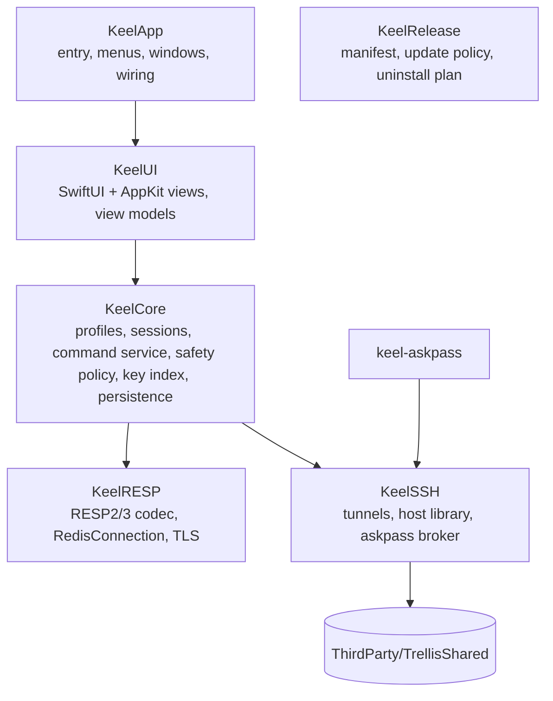

# Architecture

Keel is native Swift: SwiftUI draws the application chrome and settings; AppKit hosts the large virtualized lists, the console text view and the native responder chain. There's no webview. The package targets macOS 14 and builds in Swift 6 language mode with strict concurrency, warning-free, formatted and linted with the toolchain's `swift format` (same `.swift-format` as Trellis).

Third-party code: Sparkle 2 (updates) as a SwiftPM dependency, and `ThirdParty/TrellisShared` (vendored Bearstouch code, see [Reuse from Trellis](#reuse-from-trellis)). Nothing else.

## Modules



| Target | Role | Key types |
| --- | --- | --- |
| `KeelRESP` | Engine-independent Redis protocol: streaming RESP2/RESP3 parser and encoder, a connection actor over `NWConnection` (TCP, TLS, Unix socket), pipelining, timeouts, bounded reads. No UI, no persistence. | `RESPValue`, `RESPParser`, `RESPEncoder`, `RedisConnection` (actor), `RedisEndpoint`, `TLSConfiguration`, `RedisError` |
| `KeelSSH` | SSH tunnels through OpenSSH, saved SSH hosts, `~/.ssh/config` discovery, the askpass broker and prompt relay | `TunnelManager` (actor), `SSHTunnel`, `SavedHost`, `HostLibrary`, `SSHConfigDiscovery`, `AskpassBroker`, `PromptRelay` |
| `KeelAskpass` / `KeelAskpassMain` | The `keel-askpass` helper ssh runs as `SSH_ASKPASS`, bundled in `Contents/Helpers` | `Askpass` |
| `KeelCore` | Domain: profiles and folders, server sessions, server detection, command catalog, **safety policy**, **data command service**, key index, value pagers, bulk jobs, persistence, Keychain, settings | `ProfileStore` (actor), `ConnectionProfile`, `ServerSession` (actor), `ServerIdentity`, `CommandCatalog`, `SafetyPolicy`, `DataCommandService`, `KeyIndex`, `KeyPath`, `ValuePager`, `BulkDeleteJob`, `Persistence` (actor), `SecretStore`, `RedisURL` |
| `KeelUI` | Views and `@MainActor` view models. `KeyListDataSource` with `KeyListOutlineView` / `KeyListTableView` (AppKit, virtualized), `ConsoleTextView` (AppKit), editors, dashboard, settings, palette | `AppModel`, `WindowModel`, `TabModel`, `BrowserModel`, `ConsoleModel`, `InfoModel` |
| `KeelApp` | The `Keel` executable: `@main`, `AppDelegate`, menus built from shortcut bindings, Sparkle wiring, launch arguments (`--state-directory`, `--fixture`) | `KeelMain`, `AppDelegate` |
| `KeelRelease` | Release manifest checks, update channel policy, uninstall plan | `ReleaseManifest`, `UninstallPlanner` |
| Tests | `KeelRESPTests`, `KeelSSHTests`, `KeelCoreTests`, `KeelUITests`, `KeelReleaseTests`, plus `KeelIntegrationTests` against containerized servers | |

## Logical components

| Component | Responsibility | Where |
| --- | --- | --- |
| App shell | Native windows, tabs, sidebar, menus, palette, settings | `KeelApp`, `KeelUI` |
| Profile store | Authoritative profiles and folders, revisions, validation | `ProfileStore` |
| Secret store | Keychain read/write for profile, TLS and SSH secrets | `SecretStore` |
| Server session | Connections, tunnel, `HELLO`/`AUTH`/`SELECT`, detection, capability probing, reconnect policy | `ServerSession` |
| Command catalog | Command names, arity, flags (`write`, `readonly`, `admin`, `dangerous`, `blocking`, `pubsub`), key positions, docs for completion | `CommandCatalog` |
| Safety policy | Classifies every command before it is sent; enforces read-only, confirmations, blocked commands | `SafetyPolicy` |
| Data command service | The single entry point for every server command from editors, browser, console and bulk jobs | `DataCommandService` |
| Key index | Accumulates SCAN results, builds the namespace tree, filters, holds per-key metadata | `KeyIndex` |
| Value pagers | Paged, bounded loading of values per type (GETRANGE, HSCAN, LRANGE, SSCAN, ZRANGE/ZSCAN, XRANGE) | `ValuePager` |
| Bulk jobs | SCAN + UNLINK batches with progress, cancel and a final report | `BulkDeleteJob` |
| Persistence | Versioned atomic JSON files, backups, recovery | `Persistence` |

## One data path

Every command sent to a server, whatever its origin, goes through `DataCommandService.execute(_:origin:context:)`:

```mermaid
sequenceDiagram
    participant O as Editor / Browser / Console / Bulk job
    participant D as DataCommandService
    participant P as SafetyPolicy
    participant C as CommandCatalog
    participant S as ServerSession (actor)
    participant R as RedisConnection (actor)
    O->>D: DataRequest(command, args, origin, tab/db, confirmation?)
    D->>C: classify(command, args)
    C-->>D: flags, key positions
    D->>P: evaluate(classification, profile, origin, confirmation)
    alt blocked
        P-->>D: READ_ONLY / BLOCKED_COMMAND / CONFIRMATION_REQUIRED
        D-->>O: error (nothing sent)
    else allowed
        D->>S: send on the right connection role
        S->>R: encode → write → read reply (bounded)
        R-->>S: RESPValue or error
        S-->>D: result
        D-->>O: typed result; key index/editor invalidation
    end
```

- `DataRequest.origin` is `.editor`, `.browser`, `.console` or `.bulk`. Origin never relaxes a rule; it only selects what may run at all (scripts, admin, `KEYS`, streaming, session and unknown commands are the console's).
- The policy decides **before** anything is written to the socket. A blocked command leaves the server untouched.
- Editors don't build raw command strings; they produce typed operations (`.hashSetField(key:field:value:)`) that the service turns into commands, so the same classification runs for them.
- Multi-command edits (for example renaming a hash field) run as one `MULTI … EXEC`, optionally guarded by `WATCH`, so they apply entirely or not at all.
- Editor saves go through `DataCommandService.executeTransaction(_:unchanged:context:)`. Every write and guard read passes the policy (origin `.editor`) before the first byte; a guard read must be a read. On the database's browser connection, pinned for the whole save, the service sends `WATCH key`, repeats the guard reads the editor made when it loaded the value and compares the replies: any difference sends `UNWATCH` and fails with `CONFLICT` before anything is queued. `MULTI`, the writes and `EXEC` then go out as **one pipelined write**, so no browser command can be queued inside the transaction; a nil `EXEC` (the key changed after the reads) is also `CONFLICT`. Overwrite runs the same writes without the guard. Saves on one connection run one at a time, because `EXEC` ends every `WATCH` on its connection. `WATCH`, `MULTI`, `EXEC` and `UNWATCH` are the service's framing and stay blocked for every non-console caller.

### Safety policy

| Classification | Source | Read-only profile | Normal profile |
| --- | --- | --- | --- |
| Read (`readonly` flag, no `write`) | Catalog | Allowed | Allowed |
| Write (`write` flag) | Catalog | **Blocked** `READ_ONLY` | Allowed |
| Multi-key delete (DEL/UNLINK with > 1 key), FLUSHDB, FLUSHALL, bulk delete | Catalog + arity | Blocked | Typed confirmation |
| Script and transaction commands that may write (`EVAL`, `EVALSHA`, `FCALL`, `SCRIPT`, `FUNCTION`, `MULTI`/`EXEC` with any write inside) | Catalog | Blocked (only `EVAL_RO`/`FCALL_RO` allowed) | Console only |
| Admin / dangerous (`SHUTDOWN`, `DEBUG`, `CONFIG SET`, `REPLICAOF`, `FAILOVER`, `CLUSTER RESET`, `ACL SETUSER/DELUSER`, `MIGRATE`, `SWAPDB`, `MODULE`) | Catalog `admin`/`dangerous` | Blocked | Console only: confirmation sheet naming the command |
| `KEYS` | Fixed rule | Console only: confirmation that warns with DBSIZE | Same |
| `MONITOR`, `SUBSCRIBE`, `PSUBSCRIBE`, `SSUBSCRIBE` (and their `UNSUBSCRIBE` counterparts) | Catalog `pubsub` / fixed | Console only, on a dedicated connection with Stop | Same |
| Unknown command (not in the server's or the bundled catalog; also a module or live-only command with neither `readonly` nor `write`) | — | **Blocked** (fail closed) | Console: allowed with a notice; editors, browser and bulk jobs: denied |
| Connection state (`SELECT`, `HELLO`, `AUTH`, `RESET`, `QUIT`, `MULTI`, `EXEC`, `DISCARD`, `WATCH`, `UNWATCH`, `READONLY`, `READWRITE`, `ASKING`, `CLIENT TRACKING`, `CLIENT CACHING`) | Fixed | Console only (it keeps its own connection state) | Same; every other origin: `BLOCKED_COMMAND` |
| `CLIENT REPLY` | Fixed | Never sent: it would leave the reply queue waiting | Same |

The server's own `COMMAND INFO` / `COMMAND DOCS` (Redis 7+) is preferred; a bundled catalog generated from Redis 7.4 / Valkey 8 (checked against Valkey 9) is the fallback and is versioned in `Resources/Commands`. `CommandCatalog` rules:

- **Bundled.** `scripts/generate-command-catalog.py` reads the official `src/commands/*.json` of Redis 7.4 and Valkey 8 into `Resources/Commands/commands.json` (format `version` 1, the source versions recorded in the file). A command in both takes arity, keys and docs from Redis and the **union** of both servers' safety flags. Sentinel-only commands are left out. The Valkey 9 check fails the generator when Valkey 9 gives a catalog command a restrictive flag the catalog lacks; Valkey 9 commands the catalog lacks are listed in the file and stay unknown (fail closed) until the live catalog names them.
- **Flags.** `write`, `readonly`, `admin`, `blocking`, `pubsub`, `may_replicate` are the server's command flags (`may_replicate` marks commands that aren't `write` but may change what replicas see: `EVAL`, `FCALL`, `PUBLISH`); `dangerous` is its `@dangerous` ACL category (implied by `admin`; it also covers some reads such as `INFO` and `KEYS`). On 6.x, which has no `blocking` flag, the `@blocking` category sets it. Key positions are the legacy `COMMAND` range (first, last, step) plus `movablekeys`.
- **Access.** `write` flag → write; `readonly` without `write` → read; neither → other (`PING`, `MULTI`, `EVAL`, `SUBSCRIBE`), decided by the other flags and the fixed rules above; anything not found → **unknown**, never read.
- **Lookup.** Names are case-insensitive printable ASCII. A container (`CLIENT`, `XINFO`, `CONFIG`) resolves through its first argument to the subcommand (`client|list`); an unknown subcommand is unknown, and a name containing `|` sent as one argument is unknown (the server wouldn't run it as a subcommand either).
- **Live.** Per session Keel sends `COMMAND` (every command; the same entries as `COMMAND INFO`, and available on 6.x) and `COMMAND DOCS` (7.0+), over RESP2 or RESP3. Live entries replace bundled ones of the same name and add the ones the bundle lacks (modules, newer servers); a live entry without docs keeps the bundled docs. A server can **add** a restrictive flag (`write`, `admin`, `dangerous`, `blocking`, `pubsub`) to a bundled command but never remove one, and can drop `readonly` from a bundled command but never add it (a server can't make bundled `EVAL` a read). A server error for either command keeps the bundled data; a connection failure is reported, not hidden. At most 10,000 live commands are read.
- **Docs.** Each command carries summary, since, group, complexity and its argument tree; `syntax` renders it in redis.io notation (`SET key value [NX | XX] [GET] [EX seconds | …]`, `<a | b>` for a required choice, `value [value ...]` for repeats) for console completion hints.

`SafetyPolicy` rules (`SafetyPolicy.evaluate`, pure; `SafetyClass` names the row):

- **Classes, first match wins.** `CLIENT REPLY` → forbidden; `MONITOR` / `SUBSCRIBE` / `PSUBSCRIBE` / `SSUBSCRIBE` and `UNSUBSCRIBE` / `PUNSUBSCRIBE` / `SUNSUBSCRIBE` (one reply per channel would desynchronise a shared connection) → streaming; `KEYS` → keys; `FLUSHDB`, `FLUSHALL`, and `DEL` / `UNLINK` with more than one key → destructive; the connection-state commands above → session; `admin`, or `dangerous` with `write` (`MIGRATE`, `RESTORE`, `SWAPDB`, `SORT`) → admin (before scripts, so a scripting command a server flags `admin` stays admin); group `scripting` without `readonly` (`EVAL`, `EVALSHA`, `FCALL`, `SCRIPT …`, `FUNCTION …`) → script; `write`, or `may_replicate` without `readonly` (`PUBLISH`) → write; `readonly` → read (`KEYS` aside, `dangerous` reads such as `SORT_RO` stay reads); a core command with neither flag (`PING`, `INFO`, `ROLE`, `COMMAND`) → neutral; anything else → unknown. An empty command is forbidden.
- **Order.** (1) A read-only profile gets `READ_ONLY` for write, destructive, script, admin and unknown from every origin; no confirmation overrides it. (2) Read, write and neutral run. Destructive needs a typed confirmation (`CONFIRMATION_REQUIRED`, with the FR-SF03 typed text: the key count, `db<N>`, or the profile name for FLUSHALL). Admin and keys run from the console only, after a plain confirmation (`CONFIRMATION_REQUIRED`). Script, streaming, session and unknown run from the console only. Forbidden never runs. Everything an origin may not run is `BLOCKED_COMMAND`.
- **Confirmations.** A `CommandConfirmation` is the yes the UI (sheet) attaches to the request. It must name the same database and cover the command: exactly these argument bytes, or for `DEL` / `UNLINK` batches a confirmed key selection (FR-SF04, every key in it) or pattern (FR-SF05, every key matching it with Redis glob rules; `*` never qualifies). The shared sheet is `TypedConfirmation` (Core: operation, title, one sentence, expected bytes, the server on production — `SafetyProfile.server`) shown by `TypedConfirmationModel` / `TypedConfirmationSheet` (UI); a console refusal maps to it with `TypedConfirmation(_:profile:database:)`. `MultiKeyDelete.run` sends the selection's `UNLINK` batches of 500 under `MultiKeyDelete.confirmation(for:database:)` and reports the keys of answered batches; `KeyIndex.remove(keys:)` drops them in one rebuild. `ComplexityWarning.check` measures an O(N) console command (FR-SF08) through the data path before it is sent.
- **Console text.** `ConsoleTokenizer.arguments(_:)` (Core) splits a console line into argument bytes with redis-cli's `sdssplitargs` rules (FR-CO02); a malformed line throws `ConsoleParseError` (`INVALID_PARAMS`) before any `DataCommand` exists, so nothing is sent. `RedisCliFormatter.format(_:)` prints a reply as redis-cli's `cliFormatReplyTTY` does (FR-CO03), using `KeyDisplay.redisCliArgument` for bulk strings; a RESP3 double is printed in Redis 7's `d2string` layout, since `RESPValue` keeps the value, not its text.
- **Console session.** `ConsoleSession` (Core actor, one per console) runs a tokenized line: it asks `DataCommandService.verdict(_:origin:context:)` first (nothing sent), measures FR-SF08 sizes, and returns `needsConfirmation` / `needsGoAhead` for the UI's sheet or alert; the user's yes comes back as a `CommandConfirmation` for exactly those argument bytes. Allowed commands go through `execute` on `console(id)`; its own `SELECT` / `RESET` move the console's database and prompt only after the server's `OK`. Refusals print as `(error) KEEL_<CODE> …`. Streaming commands go through `DataCommandService.stream(_:context:)` on `stream(id)` and are read into a buffer that keeps the newest 10,000 lines until the console drains it; `stopStream(console:)` closes that connection (Stop). `closeConsole(_:)` cancels a blocking command by closing the console's connection. A console's blocking commands (catalog `blocking`) are sent with `RedisConnection.noTimeout`. `ConsoleBuffer` bounds the scrollback (10,000 lines, 16 MiB); `ConsoleHistory` (1,000, deduplicated, ⌃R search) lives per profile in memory (`ConsoleHistoryBook`, UI); `ConsoleMasking` builds the echo and history line; `ConsoleCompleter` gives names and the hint from the session's catalog. `ConsoleModel` (UI) owns the AppKit `ConsoleTextView`, where only the input after the prompt is editable and undo is off.
- **Transactions.** `MULTI` / `EXEC` are console session commands; each queued command is classified when the console sends it, so on a read-only profile a write inside a transaction is refused before it is queued. The service follows each console connection's `MULTI` from the server's replies (opened by `OK`, ended by `EXEC`, `DISCARD`, `RESET`, `QUIT` or the connection closing) and whether it has queued a command read-only refuses. A transaction that queued one while the profile was writable can't run once it is read-only: `EXEC` is refused with `READ_ONLY` and sends nothing, and the console says `DISCARD` ends the transaction (Keel sends nothing on the user's behalf, so the console's connection never gets a command the user didn't type). `EXEC` of a transaction that queued only reads still runs.
- **Routing.** `DataCommandService` sends an allowed command on `browser(db)` for editors and the browser, `console(id)` (`stream(id)` for streaming) for a console, and `job(id)` for a bulk job. A refused or malformed request (no arguments, a console or bulk command without its id: `INVALID_PARAMS`) opens no connection and sends nothing. Each connection's database is tracked: set when it opens, moved by the console's own `SELECT` / `RESET` when the server answers `OK`, and unknown while one is in flight or queued in `MULTI`. A command for `context.database` runs only on a connection known to be on it (`INVALID_PARAMS` otherwise, nothing sent), so a console that has `SELECT`ed db5 can't run a FLUSHDB confirmed for db0 and a job id reused with another database can't delete there; connection-state, pub/sub and MONITOR commands are exempt. A console therefore passes its current database. A failed open is not remembered: the next use opens again. Only read, keys and neutral commands are sent as reads; everything else reports `OUTCOME_UNKNOWN` if interrupted. The live catalog (`COMMAND`, `COMMAND DOCS`) is loaded through the same service.

Read-only mode is also defended in depth: if the server reports the ACL user can't write, the profile shows "server-enforced read-only" as well. Keel learns it from the server's answer to a write (`ServerReadOnly.refusesWrites`): `NOPERM … permissions to run` a plain data write (an ACL that refuses the command itself, not one key pattern; a refused admin, flush or script command doesn't count, since `-@admin` / `-@dangerous` users still write keys) or `READONLY` (a read-only replica), including inside `MULTI`/`EXEC`. From then until the session ends, the toolbar shows a lock and "Server-enforced read-only" and a production strip reads "Production · Read-only". No probe is sent for it (`ACL DRYRUN` and `ACL GETUSER` are admin commands).

A profile made read-only while connected locks its sessions (`DataCommandService.lockReadOnly`): every later command is evaluated as read-only, whatever context the caller holds, including a save already waiting for the connection. The lock is one way; turning read-only off takes a new session. The service also reports each write that passes the policy (and each server refusal) to its tab (`observeWrites`), which drives FR-SF07.

## Connections

`RedisConnection` is an actor wrapping one `NWConnection`. It owns a streaming `RESPParser`, a FIFO of pending replies (pipelining), per-command timeouts and a maximum reply size.

It talks to the socket through a `Transport` (`NetworkTransport` over `NWConnection` for TCP and Unix-socket `RedisEndpoint`s; in-memory fakes in tests). `send` is synchronous so bytes reach the socket in the order their replies are queued, and `receive` is pulled one chunk (≤ 64 KiB) at a time, so a fast server can't buffer data ahead of the parser. Timeouts run on an injected `sleep`, so tests drive them deterministically.

- **Lifecycle.** `idle → connecting → ready → failed | closed`. A connection is single-use: after it fails or closes, the session opens a new one. A connect that isn't ready within the connect timeout (default 10 s; the profile's value once profiles exist) fails with `TIMEOUT` (phase `connect`); an OS failure is `CONNECTION_FAILED` carrying the POSIX, DNS or TLS code for FR-CN10 mapping. `NWConnection`'s `waiting` state is a failure, not a retry.
- **Pipelining.** Every command is written as soon as it is sent and its reply is taken in order from the FIFO. RESP3 pushes (`>`) go to a separate stream (newest 256 kept) and never consume a reply. `stream(_:buffer:)` turns a connection into a stream for MONITOR / SUBSCRIBE: the command is sent with no reply slot and no timeout, every later reply and push goes to the returned stream (newest 10,000 kept), the connection refuses further commands, and `close()` ends the stream. A reply with nothing waiting is `PROTOCOL_ERROR` and closes the connection.
- **Timeouts.** Each command has a timeout (default 30 s, overridable per command). One that expires fails with `TIMEOUT` and **closes the connection**, so its late reply can never be read as the next command's.
- **Interrupted commands.** The caller says whether a command may write (default yes, so unclassified commands fail closed). When the connection ends with commands in flight, every possible write fails with `OUTCOME_UNKNOWN` (NFR-RL03), reads fail with `CONNECTION_FAILED` (drop, timeout, broken stream) or `CANCELLED` (`close()`); nothing is retried or re-sent. A caller that stops waiting gets `CANCELLED` (`OUTCOME_UNKNOWN` for a write) at once; its slot stays in the FIFO and the reply is dropped when it arrives. Sending on a connection that isn't ready is `NOT_CONNECTED` and writes nothing.
- **Bounded and silent.** Replies are bounded by the parser limits below; a codec error fails the command at the head (`OUTCOME_UNKNOWN` if it may write) and closes the connection. `KeelRESP` has no logging, so no argument or reply byte can reach a log.

`RESPParser` is incremental: it resumes where the last chunk ended, tracks aggregates on an explicit stack (no recursion) and never allocates a declared length or count before the bytes arrive. Its limits (`RESPLimits.standard`) are per reply:

| Limit | Value | Violation |
| --- | --- | --- |
| Reply size (wire bytes, headers included) | 64 MiB | `LIMIT_EXCEEDED`, checked on a bulk header before its payload arrives (NFR-RS03) |
| Aggregate elements, summed across nesting (a map entry counts twice) | 4,194,304 | `LIMIT_EXCEEDED` |
| Open aggregates plus pending attributes (nesting; each attribute wraps the value it annotates) | 128 | `PROTOCOL_ERROR` (NFR-RL05) |
| Length, count, integer, boolean or null line | 32 bytes | `PROTOCOL_ERROR` |

Also `PROTOCOL_ERROR`: an unknown type byte (caught on the first byte, so HTTP or SSH banners fail at once), negative lengths other than `$-1`/`*-1`, non-numeric or out-of-range integers, doubles outside `[+-]digits[.digits][e[+-]digits]` / `inf` / `-inf` / `nan`, a bare CR or LF, a payload not followed by CRLF, and RESP3 streamed types (`$?`, `*?`), which no supported server sends. The first error is final: the parser keeps failing and the connection is closed. RESP2's `$-1` and `*-1` and RESP3's `_` stay distinct values so every reply re-encodes byte-exactly; attributes (`|`) wrap the reply they annotate.

A `ServerSession` holds connections by **role**, so long or stateful work never blocks browsing:

| Role | Count | Used for |
| --- | --- | --- |
| `browser` | 1 per (session, db) | SCAN, TYPE/TTL pipelines, value pages, editor writes |
| `console` | 1 per console | Console commands; keeps its own `SELECT`, `CLIENT`, `MULTI` state |
| `stream` | on demand | MONITOR / SUBSCRIBE in the console; closed with Stop |
| `job` | 1 per bulk job | SCAN + UNLINK batches |

Opening a connection: connect (TCP / TLS / tunnel socket) → `HELLO 3 AUTH user pass SETNAME keel` when supported, else `AUTH` (one- or two-argument) then `CLIENT SETNAME` → `SELECT db` (not sent for db 0, every new connection's default) → on the first connection of the session, `INFO server`, capability probes and `CONFIG GET databases` (best effort, for the database switcher). `CLIENT SETNAME` is on by default and can be turned off per profile.

A saved profile connects through `ProfileSessionConnector` (KeelCore), one `ServerSession` per tab: the Keychain password bound to the profile's connection revision, the CA checked against `known-ca.json` (a changed file asks the user; declining is `TLS_CA_CHANGED` before anything opens), the profile's tunnel lease (shared by its tabs, released once when the session closes), then each role's connection runs the handshake and `SELECT`. On the browser connection it identifies the server with `INFO server` / `INFO replication` through the data path (servers below the minimum are refused and everything opened is closed), loads the server's catalog (`COMMAND`, best effort) and probes `CONFIG GET databases`. In KeelUI, `AppModel` owns every window's tabs (`ConnectionTabs`) and one `TabSession` per tab, keyed by tab ID, so a tab moved to another window keeps its connection and browser; the selected tab's content carries the tab's identity, and the console and key list hosts swap in the selected model's own AppKit view, so a tab switch never leaves another tab's console or key list on screen; Disconnect closes the tab's session and a tab that leaves every window ends it. App-wide sheets (New Connection, SSH prompts, import) present in one window only — the key window, re-chosen only while no sheet is up.

Handshake rules (`RedisConnection.handshake`): `HELLO` names the `default` user when the profile has a password but no username; with neither, no `AUTH` is sent. Only `-ERR unknown command` and `-NOPROTO` replies to `HELLO` fall back to `AUTH` on RESP2; any other error (`WRONGPASS`, `NOAUTH`, `NOPERM`) is the result. Every handshake command has the handshake timeout (`TIMEOUT`, AUTH phase) and is sent as a read, so a drop or a non-RESP reply reports itself rather than `OUTCOME_UNKNOWN`. A `SELECT` out of range asks `CONFIG GET databases` for the count, best effort. Server error text kept for details loses the `with args beginning with:` echo and any copy of the password.

Reconnect: a dropped `browser` connection reconnects on the next user action, re-runs the handshake and `SELECT`, and **never replays** a command whose reply wasn't received. A write whose reply was lost reports `OUTCOME_UNKNOWN` and refreshes the key. Console connections report the drop and reconnect only when the user runs the next command (`MULTI` state is reported lost).

### TLS

`TLSConfiguration` maps to `sec_protocol_options`:

- Minimum TLS 1.2; SNI = profile's server name (defaults to host, overridable for tunnels and IP hosts). An IP literal is never sent as SNI (RFC 6066) but is still matched against the certificate's IP names.
- **Verify block.** Keel's verify block replaces Network's default evaluation. It checks the chain first with the SSL policy and no name, so an untrusted chain reports its issuer (`TLS_UNTRUSTED`: the self-signed root's name, else the issuer named by the top certificate sent), then with the expected name (`TLS_HOSTNAME_MISMATCH` with the expected name and the certificate's DNS/IP names, or its common name when it has none). A Unix-socket endpoint with no server name override has nothing to match and fails closed. Certificate names are sanitized (no control characters, at most 128 characters, at most 16 names) before they reach a message.
- **Custom CA:** PEM bundle file reference; trust evaluated with `SecTrustSetAnchorCertificates` + `SecTrustSetAnchorCertificatesOnly(true)` in the verify block. A bundle with no readable certificate is refused when loaded; anchors that fail to decode leave fewer anchors, never the system roots. **CA fingerprints (FR-CN04):** before each connect `KnownCAStore` reads the file (symlinks followed, regular files only, at most 4 MiB), parses it, and compares the SHA-256 of its bytes with `known-ca.json`'s record for the profile. First use, or a different file chosen for the profile, records it; a different SHA-256 shows the old and new fingerprints (`AB:CD:…`) and connects only after the user accepts, with the anchors parsed from the exact bytes that were hashed. Declining (`TLS_CA_CHANGED`) or an unusable file (`TLS_CA_UNAVAILABLE`, naming the path) aborts before any connection is opened. An unreadable `known-ca.json` is preserved as `known-ca.corrupt.<UUID>.json` and replaced by an empty store marked `recordsLost`: from then on a profile without a record is asked about instead of trusted on first use. A newer-version file is never written; acceptances then hold for the session only.
- **Client certificate:** a Keychain identity (imported from `.p12`, or from PEM certificate + key through Keel's importer), referenced by persistent reference. TLS 1.3 servers check it after the client's handshake is done, so a missing or refused certificate ends the stream at the first handshake command; the handshake reports the TLS status, not a drop.
- **Skip verification:** the verify block accepts any chain; the connection reports `tlsVerified = false` and the tab, chrome strip and Info show "TLS not verified" in text. Never the default; not offered for `rediss://` URL imports unless explicitly chosen.
- **Not TLS.** A Redis server reads a TLS ClientHello as an unfinished inline command and never answers, so a TLS connect that times out or fails in the handshake opens one plain connection to the same endpoint, sends `PING` and waits at most 2 s: a RESP reply (`+PONG`, `-NOAUTH …`) means "Server may not be using TLS" (`TLS_HANDSHAKE_FAILED`). Certificate refusals, DNS and refused connections are never probed. The reverse case, a plain connection answered by a TLS record (first byte `0x15`/`0x16`), is `NOT_TLS_EXPECTED`; a TLS port that just closes stays `CONNECTION_FAILED` with the TLS hint.

**Client identity import.** On macOS `SecPKCS12Import` is the only non-deprecated API that stores a private key in the login (file-based) keychain, so every import goes through it. A `.p12` is decoded in memory first (`kSecImportToMemoryOnly`, macOS 15+; on macOS 14 the import itself is atomic), so a wrong passphrase changes nothing. A PEM/DER certificate plus a PEM PKCS#8, encrypted PKCS#8 (PBES2: PBKDF2-HMAC-SHA1/256/384/512, AES-CBC; at most 10 million rounds), PKCS#1 or SEC1 key (RSA or EC) is decoded and checked against the certificate's public key in memory, then wrapped into a PKCS#12 with a one-time passphrase and a shrouded (PBES2/AES-256) key bag, which the Keychain requires. Legacy OpenSSL-encrypted PEM keys (`Proc-Type: 4,ENCRYPTED`) are refused with a conversion hint. After the identity is in the Keychain, `Keel TLS` / `<profile-uuid>` stores `{identity: <persistent reference>, passphrase: <the user's passphrase, if any>}`; if that write fails, an identity this import added is removed again (one that was already in the Keychain is left alone). The persistent reference comes from an identity search, since the one returned for a `kSecValueRef` lookup names the certificate item.

### SSH tunnels

Keel never implements SSH. `TunnelManager` runs, without a shell (`posix_spawn` of an argument array):

```text
/usr/bin/ssh -N -T -o ExitOnForwardFailure=yes -o ServerAliveInterval=30 -o StreamLocalBindUnlink=yes \
  -L <runtime-dir>/t-<id>.sock:<redis-host>:<redis-port> [-p port] [-l user] [-i identity] -- <destination>
```

- **Arguments.** Every option is fixed by `SSHTunnelArguments`; user text only fills an option's value or the destination after `--`. A destination, user or identity path starting with `-` (e.g. `-oProxyCommand=…`), or holding whitespace (identity paths may hold spaces), control characters or characters no hostname or alias uses, is rejected before anything runs. The Redis host must be a hostname or IP literal (IPv6 is bracketed in the forward spec). Trust-bypass and command options (`StrictHostKeyChecking`, `UserKnownHostsFile`, `ProxyCommand`, `LocalCommand`, …) are never emitted; the user's own `~/.ssh/config` (including `ProxyJump`/`ProxyCommand`) still applies. An inherited `SSH_ASKPASS*` or `DISPLAY` is removed from ssh's environment; Keel supplies its own askpass (`keel-askpass`).
- The forward is a **Unix socket** in an owner-only (`0700`) runtime directory, so no local TCP port is exposed to other users and there's no port race. The Redis connection uses `NWEndpoint.unix`. The runtime directory is `<per-user $TMPDIR>/keel-run-<12 hex>`, created fresh on the first tunnel (an existing entry or symlink at that path is refused, never reused) and removed on quit; `<id>` is 12 random hex characters, so the whole socket path fits `sun_path` (104 bytes). ssh creates the socket `0600` (its default `StreamLocalBindMask`).
- **Process.** ssh runs in its own session and process group (`POSIX_SPAWN_SETSID`): it has no controlling terminal, so it can never prompt on the terminal Keel was started from. stdin and stdout are `/dev/null`; stderr goes to a pipe of which only the last 4 KiB is kept; no other descriptor is inherited.
- One tunnel per profile and tunnel configuration, reference-counted across the session's connections (`TunnelLease`; a second release of the same lease is ignored), closed 10 seconds after the last one closes: SIGTERM to the process group, SIGKILL after 1 s if it is still running. A tunnel whose ssh exits on its own is forgotten, so the next connection starts a fresh one.
- **Never signal a reused PID** (Trellis's `OwnedProcessIdentity` rule): the launch identity (pid, parent, group, start time) is revalidated before every signal, only a group leader whose parent is Keel is signalled, and the child is reaped under the same lock as the signal, so the PID can't be recycled between the check and `kill`.
- **Crash cleanup.** The runtime directory holds `owner` (the app's identity) and `t-<id>.pid` (each ssh's identity). On launch, `StaleTunnelCleanup` looks at `keel-run-*` directories in `$TMPDIR` whose owner is no longer the same live process (a running installed or development Keel is left alone), sends SIGTERM to each recorded ssh group that is still the same process, still its own group leader, reparented to launchd and running `/usr/bin/ssh`, then removes the directory. On quit the app waits (≤ ~1 s) for every tunnel to be terminated.
- **Askpass.** Every ssh launch gets `SSH_ASKPASS=<bundled keel-askpass>`, `SSH_ASKPASS_REQUIRE=force` and a fresh 64-hex nonce with the broker's socket path (owner-only folder in `$TMPDIR`, socket `0600`); the environment never carries a secret. The helper sends every prompt to `AskpassBroker`: a header line `<nonce> <kind> <byte count>` (kind `P` password, `H`/`E` typed hidden/echoed, `C` confirm, `N` notice) and ssh's prompt text (≤ 4 KiB). The broker answers only a peer with the user's UID whose executable is the bundled helper and whose parent is that launch's ssh; any other peer **revokes** the nonce, so nothing more is answered for that launch. A nonce lives for one launch only: it is withdrawn as soon as the tunnel is ready or has failed, and a new launch gets a new one.
- Passwords: the saved host password answers ssh's first password prompt of a launch only (same nonce and peer-verification design as Trellis FR-H08). The lookup is bound to the host's connection revision when the tunnel starts (`HostLibrary.savedPassword(for:gate:)`), honours the Touch ID / Mac password gate, and returns nothing once the destination, user, port or key changed (which also deletes the Keychain item). A second password prompt, or one for a host without a saved password, goes to the person.
- **Prompt relay:** ssh has no terminal here, so any other prompt (unknown or changed host key, key passphrase, one-time code, confirm, notice) is relayed through `PromptRelay` to a sheet that shows ssh's text — cut to 4 KiB, with terminal escapes and control characters other than line breaks and tabs removed. Host keys get **Reject** / **Accept** with no default button (Return never trusts a key; Escape rejects); **Accept** sends ssh's own `yes`. An unanswered prompt is cancelled after 90 s (below the helper's 120 s receive timeout) and fails, as does any prompt while no window is attached. While a prompt (or the saved password's Touch ID / Mac password check) is on screen the tunnel's connect timeout starts over, so ssh gets the full timeout after the answer. A rejected or timed-out host key fails the connection with `TUNNEL_FAILED` "Host key not accepted for <destination>." Keel never answers host-key prompts itself and never adds `StrictHostKeyChecking=no`.
- Known limitation: a `ProxyJump` hop's own ssh runs its askpass as *its* child, so its prompts fail the peer check (and revoke the nonce); such hops need their host key in `known_hosts` and key or agent authentication.
- Readiness = the socket is a socket owned by the user (never a symlink), accepts a connection within the connect timeout and its peer runs as the user; otherwise `TIMEOUT` in the tunnel phase, and ssh is terminated. ssh exiting first is `TUNNEL_FAILED` with ssh's exit status (or signal) and its last non-empty stderr line, sanitized: terminal escapes (CSI, OSC), control and bidi-format characters removed, whitespace collapsed, at most 240 characters. The message names the SSH destination, never text that was rejected as invalid.

## Key index and virtualization

- `KeyIndex` is an actor holding keys as compact `ContiguousArray<UInt8>` slices in an arena plus a parallel metadata array (type, TTL, size when requested, staleness). An open-addressing table of indices deduplicates keys SCAN repeats. Display strings are computed lazily for visible rows only. Each page is one `SCAN` through `DataCommandService` from the `.browser` origin; a page that lands after a restart (filter change, refresh) is dropped.
- SCAN pages (`COUNT` default 1,000) append to the index; with **auto-paging**, the next page is requested while the user is idle or near the end of the list, up to the configured limit (default 1,000,000 loaded keys, configurable to 10,000,000).
- Type and TTL for visible rows are fetched in pipelined `TYPE` + `PTTL` batches (or from `SCAN … TYPE` filters on 6.0+), debounced as rows scroll into view. `RowMetadataLoader` (one per tab) asks only for what is still unknown, for the rows on screen (not the fetch margin), at most 256 keys and one batch per 100 ms; a request arriving while one waits replaces its rows. A `PTTL` becomes a deadline on a monotonic clock and the list counts down from it once a second without commands, so an idle tab sends nothing (NFR-PF07). "Show sizes" adds `MEMORY USAGE key SAMPLES 0` for at most 100 keys a batch. A batch that lands after a restart is dropped. The index stores metadata packed in 8 bytes a key (type, flags, deadline in tenths of a second); measured sizes live in a side table.
- Databases and refresh (FR-KB08, FR-KB09, FR-KB12): `KeyIndex.switchDatabase(n)` moves the index's context to db n and restarts it (filters kept); `restart()` is Refresh. A scan epoch (restarts only) drops pages from before a restart; the public `generation` also changes when a key is removed from the list, since later keys move down one index — the list and metadata answers from before are dropped. `DBSIZE` (`KeyIndex.databaseSize`) and `INFO keyspace` (`DatabaseList.load`) go through the data path from the `.browser` origin. `CONFIG GET databases` is admin (console only, after a confirmation), so the switcher's count comes from `DatabaseList.probeCount`, sent at session setup like the capability probes: on the session's connection, marked a read, best effort (db0–db15 otherwise). Capability probes run on first use through `DataCommandService.supports(_:context:)`, on the browser connection like `probeCount`, and are cached for the session (`CapabilityProbe`); a probe that fails answers with the fallback. Cluster mode offers db0 only. Opening a key sends one `TYPE` (`KeyIndex.presence`); "Remove from List" (`KeyIndex.remove(key:)`) rebuilds the arena, dedup table and tree without the key — O(loaded keys) for one user action — and leaves the cursor alone.
- Filters (`KeyFilter`): pattern → `MATCH`, core type → `TYPE`, both on every page; a filter change is `KeyIndex.restart(filter:)`. The "other" type can't be named in SCAN, so each page's keys get a pipelined `TYPE` before the cursor advances (a failed check fails the page and Retry resends the same cursor). Keys added under a type filter take that type as metadata. The local filter is `KeyIndex.localMatches`: a byte substring search over the arena in chunks of 131,072 keys, so the list shows the first matches before the whole index is searched.
- The namespace tree is built off the main actor incrementally; each node stores child counts so collapsed nodes are cheap. The UI receives snapshots of the visible range only.
- `NamespaceTree` lives inside `KeyIndex` and stores no names: a folder is (source key, path end, key count, first child, next sibling) pointing into the key arena, children are one linked list of folders and keys, and a table keyed by a folder's full path finds each level with one hash. Adding a key is O(depth); a folder's children are sorted (folders first, byte order) only when it is expanded. A separator change rebuilds the tree in one pass over the arena; a restart clears it. Measured: 1M keys build in ~0.3 s and a 500,000-child folder expands in ~40 ms (release, Apple silicon).
- `NSOutlineView`/`NSTableView` with view-based reuse render only visible rows. `KeyListDataSource` keeps the selection as a key (not a row), fetches names, counts and types for the visible range plus 64 rows in one actor call, and keeps one lightweight item per tree row the outline actually asks for. Content already shown stays until a reload's fresh copy arrives, so rows don't flicker as pages load. Measured with 1M keys (release, Apple silicon): filling a scrolled-to page ~6–8 ms; expanding a 500,000-child folder ~0.36 s, of which `NSOutlineView.expandItem` itself is ~0.3 s (its per-child bookkeeping; our callbacks ~40 ms), so FR-KB04's 200 ms expand check is not yet met (tracked in [Project status](project/status.md#known-gaps)).

## Threading

- Network I/O, RESP parsing, SCAN accumulation and tree building run off the main actor (actors and `Task`s). View models are `@MainActor`.
- Every buffer that grows with server data is bounded: reply size, console scrollback, MONITOR output, key index limit, value page size.
- Cancellation is cooperative: a cancelled bulk job finishes its in-flight batch and stops before the next. Cancel is a flag the job checks between steps, never task cancellation (which would drop the in-flight `UNLINK`'s reply); the job connection closes when the job ends or its sheet closes unrun.

## Persistence

All state lives in `~/Library/Application Support/<identity>/` (`com.bearstouch.keel`, or `com.bearstouch.keel.dev` for development builds); `--state-directory` overrides it. Writes use Trellis's owner-only atomic write (temp file `O_EXCL|O_NOFOLLOW` `0600`, fsync, rename, fsync dir), single writer, sequence-gated, 300 ms debounce.

| File | Contents | Protection |
| --- | --- | --- |
| `connections.json` | Profiles, folders, ordering, labels; flags for which secrets exist (never values) | `connections.backup.json`; unreadable → preserved as `connections.corrupt.<UUID>.json` |
| `hosts.json` | Keel's own saved SSH hosts (format version 1, same shape as the vendored host library) | Backup and corrupt-file preservation |
| `windows.json` | Native windows in order, tabs (ID, profile ID, db, mode), the selected tab, frames, and the welcome screen's recent profile IDs (FR-AP08, at most 8; optional, so older files load). The selected key stays in memory: key names from browsing are never persisted. A restore keeps at most 64 windows of 128 tabs, drops tabs of deleted profiles and repeated window and tab IDs; while `connections.json` can't be used (recovery, newer version) the file isn't saved, so its tabs aren't lost | Backup |
| `settings.json` | Settings window (FR-AP09): theme, restore at launch, browser defaults, default viewer, console protocol, advanced connection defaults | Backup |
| `instance.lock` | The MAC-17 single-instance lock: an exclusive `flock` held for the process's life, with the holder's PID (no state) | `0600`, never followed through a link |
| `known-ca.json` | Per profile (UUID key): CA file path and SHA-256; `recordsLost` after a recovery | `0600`, no backup; corrupt-file preservation, then unknown profiles are asked about |

Each file is a flat JSON object with an integer `schemaVersion` beside the document's own keys, written by one `Persistence` actor per file (KeelCore). Reads never follow symlinks, are capped at 4 MiB and 128 nesting levels, and give `.missing`, `.loaded` or `.recovery(reason, backup)`; saving stays off until a file has loaded (or is missing), so nothing unread is overwritten. Before each save the previous good file becomes the backup. Saves carry a caller-assigned sequence (an older one never replaces a newer one); `scheduleSave` debounces 300 ms and `flush()` writes immediately on quit. Recovery offers **Recover backup** / **Start empty**; the original is first copied to `<name>.corrupt.<UUID>.json`. A file with a newer `schemaVersion` — at load or seen mid-session — makes that file read-only for the rest of the session: recovery is refused and the backup can only be used in memory. A symlinked file, backup or state folder is refused.

`UserDefaults`: keyboard bindings, Sparkle preferences. **Never persisted:** values, key names from browsing, console output, console history (unless P1 opt-in, with AUTH-type commands always redacted), passwords. Versioned formats: bump, migrate, test the old format; newer unknown versions open read-only and are never overwritten.

### Keychain items

| Service | Account | Item |
| --- | --- | --- |
| `Keel Connection` | `<profile-uuid>` | Redis password (ACL or `requirepass`) |
| `Keel TLS` | `<profile-uuid>` | Client identity (persistent reference) and key passphrase |
| `Keel SSH Host` | `<host-uuid>` | Saved SSH password |

All generic passwords use *when unlocked, this device only*. The Keychain is written before metadata; a failed metadata write restores the previous Keychain value. Changing a profile's host, port, username, TLS server name or tunnel, turning TLS off or turning **Skip verification** on removes its saved password (connection-revision binding, as in Trellis FR-H09). Turning TLS on or verification back on keeps it.

### Profile store

`ProfileStore` (KeelCore actor) is the single owner of `connections.json` and the `Keel Connection` / `Keel TLS` items, through an injected `SecretStore`.

- Every mutation validates first (option-like or spaced hosts, invalid tunnels, out-of-range ports, databases, timeouts and 1–4 byte separators are refused), then writes the Keychain, then the metadata. A failed metadata write undoes the Keychain changes in reverse; a Keychain failure writes no metadata. Mutations are serialized, and `connections.json` is saved immediately rather than debounced, because the rollback depends on the write's outcome.
- Each change stamps the record with the next store revision; editors pass the revision they started from and a stale one gets `CONFLICT`. An unchanged save keeps the revision. `connectionRevision` advances only when host, port, username, TLS server name or tunnel changes, or the transport is weakened (TLS off, Skip verification on); that removes the saved password unless the same save sets a new one, and a password lookup is bound to the connection revision the connect resolved and waits for an in-flight mutation (whose Keychain write precedes its metadata).
- The file holds `hasPassword` / `hasTLSSecret` flags only. On load every record is re-validated (unique IDs, revisions not above the document's, folders that exist, valid settings); a file that fails goes through recovery.
- Duplicate copies the profile's Keychain items to the copy. Delete removes both items first (restored if the metadata write fails); the client identity itself (certificate and key) stays in the Keychain, since other profiles or apps may use it. Deleting a folder moves its profiles to the top level.
- Labels: one per color (FR-CN02), each with an editable name. Red is the built-in **Production** label and is always treated as production; any other label can be marked "treat as production" (FR-SF02).

## Logging and diagnostics

- `KeelLog` (KeelCore) is the only writer to the unified log (subsystem = bundle ID; categories `connection`, `data`, `jobs`, `app`). A message is a static event name plus typed fields: SCREAMING_SNAKE codes (anything else becomes `INVALID_CODE`), named counts and `ServerKind`s are public; `serverText` (a host, an error reply) is `privacy: .private` in debug builds and dropped in release builds (NFR-PV02). Values, key names, commands and console text are never passed to it. `SourceScanTests` fails on `print`, `NSLog`, `os_log`, `Logger`, `privacy: .public` or stdout/stderr writes anywhere else in `Sources/` or `ThirdParty/TrellisShared/`, except the launch-failure message and the askpass reply.
- Logged today: the data path's refusals (`command.refused`, `transaction.refused`, info level) and failures (`command.failed`, `transaction.failed`, error level), each with its error code only, connect results (category code; server family) and bulk delete completion (scan, match and delete counts, stop code).
- Error-level codes also go to an in-memory, bounded (`DiagnosticsRecorder.errorLimit` = 50) `DiagnosticsRecorder`, with connections per server family. Help → Export Diagnostics writes `DiagnosticsReport` as JSON where the user chooses: `appVersion`, `macOSVersion`, `architecture`, `profileCount`, `serverTypes`, `recentErrors` (code and time) and `generatedAt`, nothing else (FR-AP10). Nothing of it is persisted otherwise.

## Errors

Internally every failure is a `KeelError` with a SCREAMING_SNAKE `code` from the table below, a sanitized message that names the target and the recovery, and optional server error text (`ERR`, `WRONGTYPE`, `NOPERM`, …) passed through verbatim. Messages never include passwords or values. New codes are SCREAMING_SNAKE and are added here; connection failures also carry an FR-CN10 category (`DNS_FAILED`, `TLS_UNTRUSTED`, `AUTH_FAILED`, `TUNNEL_FAILED`, `DB_OUT_OF_RANGE`, …), listed in [Functional requirements](requirements/functional.md#connection-error-categories-fr-cn10).

| Code | When | Retryable |
| --- | --- | --- |
| `INVALID_PARAMS` | Bad arguments: an empty command, a console or bulk command without its id, a database the connection isn't known to be on | no |
| `READ_ONLY` | Write, destructive, script, admin or unknown command on a read-only profile | no |
| `BLOCKED_COMMAND` | Command not allowed from this origin (a script, admin, `KEYS`, `MONITOR`/`SUBSCRIBE`, session or unknown command outside the console), or never sent (`CLIENT REPLY`) | no |
| `CONFIRMATION_REQUIRED` | Destructive, admin or `KEYS` command without a matching confirmation; the UI asks (typed text for destructive, FR-SF03) and resends | yes, after confirmation |
| `CONFLICT` | Key exists for create, rename target exists, stale profile revision, `WATCH` conflict | sometimes |
| `WRONG_TYPE` | Operation doesn't match the key's type (server `WRONGTYPE`) | no |
| `NOT_FOUND` | Profile or job doesn't exist; key missing where it must exist | no |
| `PERMISSION_DENIED` | ACL `NOPERM` from the server (server text kept) | no |
| `NOT_CONNECTED` / `CONNECTION_FAILED` | Connection not open or failed (category from FR-CN10) | yes |
| `PROTOCOL_ERROR` | The server sent something that isn't valid RESP or not the reply shape expected; the connection is closed | yes, on a new connection |
| `TIMEOUT` | Connect, tunnel or command exceeded its timeout; outcome of writes is unknown | no for writes |
| `OUTCOME_UNKNOWN` | Connection dropped after a write was sent | no |
| `CANCELLED` | The request was cancelled, or Keel closed the connection, before a read's reply arrived (a write in flight reports `OUTCOME_UNKNOWN` instead) | yes |
| `LIMIT_EXCEEDED` | Reply size, page, key count or other bound exceeded | usually |
| `SERVER_ERROR` | Any other server error, text kept | no |
| `UNSUPPORTED` | Server lacks the needed command (e.g. `OBJECT ENCODING` on Dragonfly) | no |
| `UNSUPPORTED_SERVER` | Server version is below Redis 6.0 | no |

## Testing and injection

- Time, the filesystem, the Keychain, processes (ssh), and transports are injected. `RedisConnection` accepts a transport protocol so `KeelRESPTests` run against in-memory fakes, including fragmented and malformed frames.
- `KeelIntegrationTests` run against containerized Redis 6.0, 6.2, 7.4, 8.x, Valkey 7.2, 8.x and 9.x and Dragonfly 1.x (TLS and ACL fixtures included), with a local `sshd` container for tunnels. They never touch a user's servers. `scripts/integration-matrix.py` starts the containers from `Tests/Fixtures/Integration/matrix.json` (each image pinned by digest; a Redis 5 container for the minimum-version refusal; three TLS servers from `Tests/Fixtures/TLS`; an Alpine bastion built from `Tests/Fixtures/SSH/Dockerfile` with Redis on its own loopback and fresh keys per run), publishes every port on 127.0.0.1 only, and passes the tests ports, never hosts (`KEEL_INTEGRATION_SERVERS`, `KEEL_INTEGRATION_REFUSED_PORT`, `KEEL_INTEGRATION_TLS_*`, `KEEL_INTEGRATION_SSH_*`). Per server, `ServerMatrixTests` cover Test Connection and detection, SCAN browsing, each core editor's guarded save, the console, the bulk delete and a restricted ACL user. The tests skip without `KEEL_INTEGRATION=1`; the script also sets `KEEL_INTEGRATION_REQUIRED=1`, which turns a missing fixture into a failure. CI runs it on every push and pull request (`integration` job), and it writes `.build/integration/evidence.json`.
- Console golden tests (NFR-QA04) compare `RedisCliFormatter` with real redis-cli output in `Tests/Fixtures/Console` (raw reply bytes and printed text per case, RESP2 and RESP3), captured by `scripts/capture-console-goldens.py` against a throwaway local `redis-server`; `VERSION` records the redis-cli that printed them.
- Large-data benchmarks (1M and 10M keys) live in `scripts/bench-browser.py` and record evidence in `.build/bench/evidence.json`. It runs the KeelCoreTests performance tests (in-memory fakes), `KeelIntegrationTests.BrowserBenchmarkTests` against a throwaway server it seeds (a container or a local `redis-server`, loopback only, nothing on disk), and launches the app with 200 saved profiles; `KEEL_LAUNCH_METRICS=/abs/file` makes the first sidebar render write the seconds since process start (NFR-PF01). The benchmark tests run only with `KEEL_BENCH=1`, so a plain `swift test` never needs a server.

## Reuse from Trellis

Copied at build time into `ThirdParty/TrellisShared` with `PROVENANCE.md` (Trellis commit, files, local changes). This is source reuse only: Keel is an independent app and never touches Trellis's files, settings or Keychain items at run time.

| Trellis source | Used for |
| --- | --- |
| `SavedHost.swift`, `HostLibrary.swift`, `SSHConfigDiscovery.swift`, `HostSecrets.swift` | SSH hosts, discovery, Keychain passwords |
| `AskpassBroker.swift`, `TrellisAskpass/Askpass.swift` | `keel-askpass`, extended with the prompt relay |
| `WorkspacePersistence` owner-only storage helpers | Atomic owner-only writes |
| `KeyboardShortcuts.swift` | Rebindable shortcuts with conflict detection |
| Trellis's default terminal colors (`#151719` background, ANSI palette) | Console; the rest of the palette is Keel's own ([Design](design/index.md)) |

Identifiers are renamed (`Keel…`, Keychain services above, env prefix `KEEL_`). Any change to the copied code is recorded in `PROVENANCE.md`.

Each vendored file sits in `ThirdParty/TrellisShared/<Target>` and is compiled into that Keel target through the symlink `Sources/<Target>/TrellisShared`. Keel vendors the SSH host library, discovery, askpass, owner-only storage and shortcut bindings; the console copies the terminal colors.
