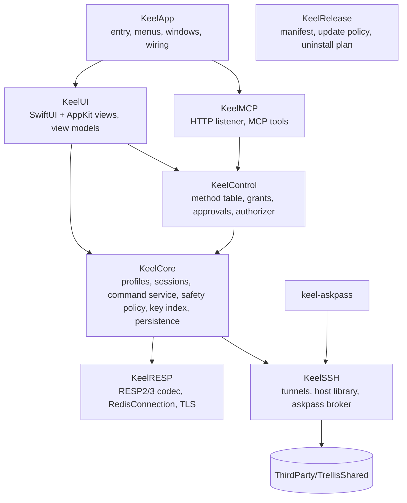

# 02 Architecture

Keel is native Swift: SwiftUI draws the application chrome and settings; AppKit hosts the large virtualized lists, the console text view and the native responder chain. There's no webview. The package targets macOS 14 and builds in Swift 6 language mode with strict concurrency, warning-free, formatted and linted with the toolchain's `swift format` (same `.swift-format` as Trellis).

Third-party code: Sparkle 2 (updates) as a SwiftPM dependency, and `ThirdParty/TrellisShared` (vendored Bearstouch code, see [Reuse from Trellis](#reuse-from-trellis)). Nothing else.

## Modules



| Target | Role | Key types |
| --- | --- | --- |
| `KeelRESP` | Engine-independent Redis protocol: streaming RESP2/RESP3 parser and encoder, a connection actor over `NWConnection` (TCP, TLS, Unix socket), pipelining, timeouts, bounded reads. No UI, no persistence. | `RESPValue`, `RESPParser`, `RESPEncoder`, `RedisConnection` (actor), `RedisEndpoint`, `TLSConfiguration`, `RedisError` |
| `KeelSSH` | SSH tunnels through OpenSSH, saved SSH hosts, `~/.ssh/config` discovery, the askpass broker and prompt relay | `TunnelManager` (actor), `SSHTunnel`, `SavedHost`, `HostLibrary`, `SSHConfigDiscovery`, `AskpassBroker`, `PromptRelay` |
| `KeelAskpass` / `KeelAskpassMain` | The `keel-askpass` helper ssh runs as `SSH_ASKPASS`, bundled in `Contents/Helpers` | `Askpass` |
| `KeelCore` | Domain: profiles and folders, server sessions, server detection, command catalog, **safety policy**, **data command service**, key index, value pagers, bulk jobs, persistence, Keychain, settings | `ProfileStore` (actor), `ConnectionProfile`, `ServerSession` (actor), `ServerIdentity`, `CommandCatalog`, `SafetyPolicy`, `DataCommandService`, `KeyIndex`, `KeyPath`, `ValuePager`, `BulkDeleteJob`, `Persistence` (actor), `SecretStore`, `RedisURL` |
| `KeelControl` | Transport-independent agent API: method table, grants, capabilities, connection scope, approvals, idempotency, limits, activity log | `ControlHandler`, `AuthorizingControlHandler`, `AuthorizationPolicy`, `GrantStore`, `KeychainGrantSecretStore`, `ApprovalCenter` (actor), `ActivityLog` |
| `KeelMCP` | Optional MCP server (Streamable HTTP), off by default | `MCPServer`, `MCPListener`, `MCPEndpoint`, `MCPTools`, `HTTPRequestParser` |
| `KeelUI` | Views and `@MainActor` view models. `KeyOutlineView` / `KeyTableView` (AppKit, virtualized), `ConsoleTextView` (AppKit), editors, dashboard, settings, palette | `AppModel`, `WindowModel`, `TabModel`, `BrowserModel`, `ConsoleModel`, `InfoModel`, `ApprovalPanel` |
| `KeelApp` | The `Keel` executable: `@main`, `AppDelegate`, menus built from shortcut bindings, Sparkle wiring, launch arguments (`--state-directory`, `--no-mcp`, `--fixture`) | `KeelMain`, `AppDelegate` |
| `KeelRelease` | Release manifest checks, update channel policy, uninstall plan | `ReleaseManifest`, `UninstallPlanner` |
| Tests | `KeelRESPTests`, `KeelSSHTests`, `KeelCoreTests`, `KeelControlTests`, `KeelMCPTests`, `KeelUITests`, `KeelReleaseTests`, plus `KeelIntegrationTests` against containerized servers | |

## Logical components

| Component | Responsibility | Where |
| --- | --- | --- |
| App shell | Native windows, tabs, sidebar, menus, palette, settings | `KeelApp`, `KeelUI` |
| Profile store | Authoritative profiles and folders, revisions, validation | `ProfileStore` |
| Secret store | Keychain read/write for profile, SSH and grant secrets | `SecretStore`, `KeychainGrantSecretStore` |
| Server session | Connections, tunnel, `HELLO`/`AUTH`/`SELECT`, detection, capability probing, reconnect policy | `ServerSession` |
| Command catalog | Command names, arity, flags (`write`, `readonly`, `admin`, `dangerous`, `blocking`, `pubsub`), key positions, docs for completion | `CommandCatalog` |
| Safety policy | Classifies every command before it is sent; enforces read-only, confirmations, blocked commands | `SafetyPolicy` |
| Data command service | The single entry point for every server command from editors, browser, console, bulk jobs and agents | `DataCommandService` |
| Key index | Accumulates SCAN results, builds the namespace tree, filters, holds per-key metadata | `KeyIndex` |
| Value pagers | Paged, bounded loading of values per type (GETRANGE, HSCAN, LRANGE, SSCAN, ZRANGE/ZSCAN, XRANGE) | `ValuePager` |
| Bulk jobs | SCAN + UNLINK batches with progress, cancel and a final report | `BulkDeleteJob` |
| Persistence | Versioned atomic JSON files, backups, recovery | `Persistence` |
| Agent API | Grants, authorization, approvals, tool table, MCP transport | `KeelControl`, `KeelMCP` |

## One data path

Every command sent to a server, whatever its origin, goes through `DataCommandService.execute(_:origin:context:)`:

```mermaid
sequenceDiagram
    participant O as Editor / Console / Bulk job / MCP tool
    participant D as DataCommandService
    participant P as SafetyPolicy
    participant C as CommandCatalog
    participant S as ServerSession (actor)
    participant R as RedisConnection (actor)
    O->>D: DataRequest(command, args, origin, tab/db, confirmation?)
    D->>C: classify(command, args)
    C-->>D: flags, key positions
    D->>P: evaluate(classification, profile, origin, confirmation)
    alt blocked
        P-->>D: READ_ONLY / BLOCKED_COMMAND / CONFIRMATION_REQUIRED / APPROVAL_REQUIRED
        D-->>O: error (nothing sent)
    else allowed
        D->>S: send on the right connection role
        S->>R: encode → write → read reply (bounded)
        R-->>S: RESPValue or error
        S-->>D: result
        D-->>O: typed result; key index/editor invalidation
    end
```

- `DataRequest.origin` is `.editor`, `.browser`, `.console`, `.bulk` or `.agent(grantID)`. Origin never relaxes a rule; it only selects how a confirmation is obtained (a sheet for the UI, an approval for agents).
- The policy decides **before** anything is written to the socket. A blocked command leaves the server untouched.
- Editors don't build raw command strings; they produce typed operations (`.hashSetField(key:field:value:)`) that the service turns into commands, so the same classification runs for them.
- Multi-command edits (for example renaming a hash field) run as one `MULTI … EXEC`, optionally guarded by `WATCH`, so they apply entirely or not at all.

### Safety policy

| Classification | Source | Read-only profile | Normal profile |
| --- | --- | --- | --- |
| Read (`readonly` flag, no `write`) | Catalog | Allowed | Allowed |
| Write (`write` flag) | Catalog | **Blocked** `READ_ONLY` | Allowed |
| Multi-key delete (DEL/UNLINK with > 1 key), FLUSHDB, FLUSHALL, bulk delete | Catalog + arity | Blocked | Typed confirmation (UI) or approval (agent) |
| Script and transaction commands that may write (`EVAL`, `EVALSHA`, `FCALL`, `SCRIPT`, `FUNCTION`, `MULTI`/`EXEC` with any write inside) | Catalog | Blocked (only `EVAL_RO`/`FCALL_RO` allowed) | Allowed (console); agents need `command.execute` |
| Admin / dangerous (`SHUTDOWN`, `DEBUG`, `CONFIG SET`, `REPLICAOF`, `FAILOVER`, `CLUSTER RESET`, `ACL SETUSER/DELUSER`, `MIGRATE`, `SWAPDB`, `MODULE`) | Catalog `admin`/`dangerous` | Blocked | Console: confirmation sheet naming the command. Agents: **always denied** in v1 (`BLOCKED_COMMAND`) |
| `KEYS` | Fixed rule | Console: confirmation that warns with DBSIZE | Same; agents: denied, use `key_scan` |
| `MONITOR`, `SUBSCRIBE`, `PSUBSCRIBE`, `SSUBSCRIBE` | Catalog `pubsub` / fixed | Console only, on a dedicated connection with Stop | Same; agents: denied |
| Unknown command (not in the server's or the bundled catalog) | — | **Blocked** (fail closed) | Console: allowed with a notice; agents: denied |

The server's own `COMMAND INFO` / `COMMAND DOCS` (Redis 7+) is preferred; a bundled catalog generated from Redis 7.4 / Valkey 8 is the fallback and is versioned in `Resources/Commands`. Read-only mode is also defended in depth: if the server reports the ACL user can't write, the profile shows "server-enforced read-only" as well.

## Connections

`RedisConnection` is an actor wrapping one `NWConnection`. It owns a streaming `RESPParser`, a FIFO of pending replies (pipelining), per-command timeouts and a maximum reply size.

A `ServerSession` holds connections by **role**, so long or stateful work never blocks browsing:

| Role | Count | Used for |
| --- | --- | --- |
| `browser` | 1 per (session, db) | SCAN, TYPE/TTL pipelines, value pages, editor writes |
| `console` | 1 per console | Console commands; keeps its own `SELECT`, `CLIENT`, `MULTI` state |
| `stream` | on demand | MONITOR / SUBSCRIBE in the console; closed with Stop |
| `job` | 1 per bulk job | SCAN + UNLINK batches |
| `agent` | 1 per (grant, profile, db) | MCP tool calls |

Opening a connection: connect (TCP / TLS / tunnel socket) → `HELLO 3 AUTH user pass SETNAME keel` when supported, else `AUTH` (one- or two-argument) then `CLIENT SETNAME` → `SELECT db` → on the first connection of the session, `INFO server` and capability probes. `CLIENT SETNAME` is on by default and can be turned off per profile.

Reconnect: a dropped `browser` connection reconnects on the next user action, re-runs the handshake and `SELECT`, and **never replays** a command whose reply wasn't received. A write whose reply was lost reports `OUTCOME_UNKNOWN` and refreshes the key. Console connections report the drop and reconnect only when the user runs the next command (`MULTI` state is reported lost).

### TLS

`TLSConfiguration` maps to `sec_protocol_options`:

- Minimum TLS 1.2; SNI = profile's server name (defaults to host, overridable for tunnels and IP hosts).
- **Custom CA:** PEM bundle file reference; trust evaluated with `SecTrustSetAnchorCertificates` + `SecTrustSetAnchorCertificatesOnly(true)` in the verify block. The CA file's SHA-256 is stored; a changed file prompts before it is trusted.
- **Client certificate:** a Keychain identity (imported from `.p12`, or from PEM certificate + key through Keel's importer), referenced by persistent reference.
- **Skip verification:** the verify block accepts any chain; the tab, chrome strip and Info show "TLS not verified" in text. Never the default; not offered for `rediss://` URL imports unless explicitly chosen.

### SSH tunnels

Keel never implements SSH. `TunnelManager` runs, without a shell:

```text
/usr/bin/ssh -N -T -o ExitOnForwardFailure=yes -o ServerAliveInterval=30 -o StreamLocalBindUnlink=yes \
  -L <runtime-dir>/t-<uuid>.sock:<redis-host>:<redis-port> [-p port] [-l user] [-i identity] <destination>
```

- The forward is a **Unix socket** in an owner-only (`0700`) runtime directory, so no local TCP port is exposed to other users and there's no port race. The Redis connection uses `NWEndpoint.unix`.
- One tunnel per profile, reference-counted across the session's connections, closed 10 seconds after the last one closes, terminated by process group, never signalling a reused PID (Trellis's `OwnedProcessIdentity` rule).
- Passwords: the saved host password is answered once, for ssh's password prompt only, through `keel-askpass` and the askpass broker (same nonce and peer-verification design as Trellis FR-H08).
- **Prompt relay:** ssh has no terminal here, so any other prompt (unknown or changed host key, key passphrase, one-time code) is relayed by `keel-askpass` to the app, which shows the exact prompt in a sheet. Keel never answers host-key prompts itself and never adds `StrictHostKeyChecking=no`.
- Readiness = the socket accepts a connection within the connect timeout. Failure reports ssh's exit status and a sanitized last stderr line.

## Key index and virtualization

- `KeyIndex` is an actor holding keys as compact `ContiguousArray<UInt8>` slices in an arena plus a parallel metadata array (type, TTL, size when requested, staleness). Display strings are computed lazily for visible rows only.
- SCAN pages (`COUNT` default 1,000) append to the index; with **auto-paging**, the next page is requested while the user is idle or near the end of the list, up to the configured limit (default 1,000,000 loaded keys, configurable to 10,000,000).
- Type and TTL for visible rows are fetched in pipelined `TYPE` + `PTTL` batches (or from `SCAN … TYPE` filters on 6.0+), debounced as rows scroll into view.
- The namespace tree is built off the main actor incrementally; each node stores child counts so collapsed nodes are cheap. The UI receives snapshots of the visible range only.
- `NSOutlineView`/`NSTableView` with view-based reuse render only visible rows.

## Threading

- Network I/O, RESP parsing, SCAN accumulation and tree building run off the main actor (actors and `Task`s). View models are `@MainActor`.
- Every buffer that grows with server data is bounded: reply size, console scrollback, MONITOR output, key index limit, value page size.
- Cancellation is cooperative: a cancelled bulk job finishes its in-flight batch and stops before the next.

## Persistence

All state lives in `~/Library/Application Support/<identity>/` (`com.bearstouch.keel`, or `com.bearstouch.keel.dev` for development builds); `--state-directory` overrides it. Writes use Trellis's owner-only atomic write (temp file `O_EXCL|O_NOFOLLOW` `0600`, fsync, rename, fsync dir), single writer, sequence-gated, 300 ms debounce.

| File | Contents | Protection |
| --- | --- | --- |
| `connections.json` | Profiles, folders, ordering, labels; flags for which secrets exist (never values) | `connections.backup.json`; unreadable → preserved as `connections.unreadable.<UUID>.json` |
| `hosts.json` | Keel's own saved SSH hosts (format version 1, same shape as the vendored host library) | Backup and unreadable-file preservation |
| `windows.json` | Native windows, tabs (profile ID, db, mode, selected key path), splits, frames | Backup |
| `settings.json` | Appearance, browser defaults, console options, remote-control settings | Backup |
| `grants.json` | Agent grant metadata with token **hashes** only | Unreadable → preserved, store read-only |
| `known-ca.json` | CA file fingerprints per profile | `0600` |

`UserDefaults`: keyboard bindings, Sparkle preferences. **Never persisted:** values, key names from browsing, console output, console history (unless P1 opt-in, with AUTH-type commands always redacted), passwords, tokens, MCP request bodies. Versioned formats: bump, migrate, test the old format; newer unknown versions open read-only and are never overwritten.

### Keychain items

| Service | Account | Item |
| --- | --- | --- |
| `Keel Connection` | `<profile-uuid>` | Redis password (ACL or `requirepass`) |
| `Keel TLS` | `<profile-uuid>` | Client identity (persistent reference) and key passphrase |
| `Keel SSH Host` | `<host-uuid>` | Saved SSH password |
| `Keel Automation` | `<grant-uuid>` | Grant token |

All generic passwords use *when unlocked, this device only*. The Keychain is written before metadata; a failed metadata write restores the previous Keychain value. Changing a profile's host, port, username, TLS server name or tunnel removes its saved password (connection-revision binding, as in Trellis FR-H09).

## Errors

Internally every failure is a `KeelError` with a SCREAMING_SNAKE `code` shared with the [API](05-api.md#errors), a sanitized message that names the target and the recovery, and optional server error text (`ERR`, `WRONGTYPE`, `NOPERM`, …) passed through verbatim. Messages never include passwords, tokens or values.

## Testing and injection

- Time, the filesystem, the Keychain, processes (ssh), and transports are injected. `RedisConnection` accepts a transport protocol so `KeelRESPTests` run against in-memory fakes, including fragmented and malformed frames.
- `KeelIntegrationTests` run against containerized Redis 6.0, 6.2, 7.4, 8.x, Valkey 8 and Dragonfly 1.x (TLS and ACL fixtures included), with a local `sshd` container for tunnels. They never touch a user's servers.
- Large-data benchmarks (1M and 10M keys) live in `scripts/bench-browser.py` and record evidence in `.build/`.

## Reuse from Trellis

Copied at build time into `ThirdParty/TrellisShared` with `PROVENANCE.md` (Trellis commit, files, local changes). This is source reuse only: Keel is an independent app and never touches Trellis's files, settings or Keychain items at run time.


| Trellis source | Used for |
| --- | --- |
| `SavedHost.swift`, `HostLibrary.swift`, `SSHConfigDiscovery.swift`, `HostSecrets.swift` | SSH hosts, discovery, Keychain passwords |
| `AskpassBroker.swift`, `TrellisAskpass/Askpass.swift` | `keel-askpass`, extended with the prompt relay |
| `WorkspacePersistence` owner-only storage helpers | Atomic owner-only writes |
| `KeyboardShortcuts.swift` | Rebindable shortcuts with conflict detection |
| `TrellisMCP` HTTP parser, listener, endpoint | MCP transport and its security controls |
| `TrellisControl` grant store, authorization pattern | Grants and the authorizer |
| Trellis's default terminal colors (`#151719` background, ANSI palette) | Console; the rest of the palette is Keel's own ([08 Design](08-design.md)) |

Identifiers are renamed (`Keel…`, Keychain services above, env prefix `KEEL_`). Any change to the copied code is recorded in `PROVENANCE.md`.
