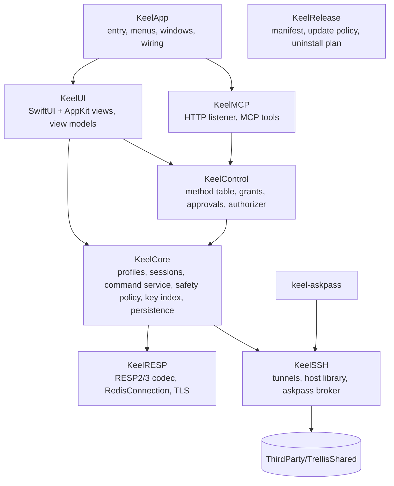

# 02 Architecture

Keel is native Swift: SwiftUI draws the application chrome and settings; AppKit hosts the large virtualized lists, the console text view and the native responder chain. There's no webview. The package targets macOS 14 and builds in Swift 6 language mode with strict concurrency, warning-free, formatted and linted with the toolchain's `swift format` (same `.swift-format` as Trellis).

Third-party code: Sparkle 2 (updates) as a SwiftPM dependency, and `ThirdParty/TrellisShared` (vendored Bearstouch code, see [Reuse from Trellis](#reuse-from-trellis)). Nothing else.

## Modules



| Target | Role | Key types |
| --- | --- | --- |
| `KeelRESP` | Engine-independent Redis protocol: streaming RESP2/RESP3 parser and encoder, a connection actor over `NWConnection` (TCP, TLS, Unix socket), pipelining, timeouts, bounded reads. No UI, no persistence. | `RESPValue`, `RESPParser`, `RESPEncoder`, `RedisConnection` (actor), `RedisEndpoint`, `TLSConfiguration`, `RedisError` |
| `KeelSSH` | SSH tunnels through OpenSSH, saved SSH hosts, `~/.ssh/config` discovery, the askpass broker and prompt relay | `TunnelManager` (actor), `SSHTunnel`, `SavedHost`, `HostLibrary`, `SSHConfigDiscovery`, `AskpassBroker`, `PromptRelay` |
| `KeelAskpass` / `KeelAskpassMain` | The `keel-askpass` helper ssh runs as `SSH_ASKPASS`, bundled in `Contents/Helpers` | `Askpass` |
| `KeelCore` | Domain: profiles and folders, server sessions, server detection, command catalog, **safety policy**, **data command service**, key index, value pagers, bulk jobs, persistence, Keychain, settings | `ProfileStore` (actor), `ConnectionProfile`, `ServerSession` (actor), `ServerIdentity`, `CommandCatalog`, `SafetyPolicy`, `DataCommandService`, `KeyIndex`, `KeyPath`, `ValuePager`, `BulkDeleteJob`, `Persistence` (actor), `SecretStore`, `RedisURL` |
| `KeelControl` | Transport-independent agent API: method table, grants, capabilities, connection scope, approvals, idempotency, limits, activity log | `ControlHandler`, `AuthorizingControlHandler`, `AuthorizationPolicy`, `GrantStore`, `KeychainGrantSecretStore`, `ApprovalCenter` (actor), `ActivityLog` |
| `KeelMCP` | Optional MCP server (Streamable HTTP), off by default | `MCPServer`, `MCPListener`, `MCPEndpoint`, `MCPTools`, `HTTPRequestParser` |
| `KeelUI` | Views and `@MainActor` view models. `KeyOutlineView` / `KeyTableView` (AppKit, virtualized), `ConsoleTextView` (AppKit), editors, dashboard, settings, palette | `AppModel`, `WindowModel`, `TabModel`, `BrowserModel`, `ConsoleModel`, `InfoModel`, `ApprovalPanel` |
| `KeelApp` | The `Keel` executable: `@main`, `AppDelegate`, menus built from shortcut bindings, Sparkle wiring, launch arguments (`--state-directory`, `--no-mcp`, `--fixture`) | `KeelMain`, `AppDelegate` |
| `KeelRelease` | Release manifest checks, update channel policy, uninstall plan | `ReleaseManifest`, `UninstallPlanner` |
| Tests | `KeelRESPTests`, `KeelSSHTests`, `KeelCoreTests`, `KeelControlTests`, `KeelMCPTests`, `KeelUITests`, `KeelReleaseTests`, plus `KeelIntegrationTests` against containerized servers | |

## Logical components

| Component | Responsibility | Where |
| --- | --- | --- |
| App shell | Native windows, tabs, sidebar, menus, palette, settings | `KeelApp`, `KeelUI` |
| Profile store | Authoritative profiles and folders, revisions, validation | `ProfileStore` |
| Secret store | Keychain read/write for profile, SSH and grant secrets | `SecretStore`, `KeychainGrantSecretStore` |
| Server session | Connections, tunnel, `HELLO`/`AUTH`/`SELECT`, detection, capability probing, reconnect policy | `ServerSession` |
| Command catalog | Command names, arity, flags (`write`, `readonly`, `admin`, `dangerous`, `blocking`, `pubsub`), key positions, docs for completion | `CommandCatalog` |
| Safety policy | Classifies every command before it is sent; enforces read-only, confirmations, blocked commands | `SafetyPolicy` |
| Data command service | The single entry point for every server command from editors, browser, console, bulk jobs and agents | `DataCommandService` |
| Key index | Accumulates SCAN results, builds the namespace tree, filters, holds per-key metadata | `KeyIndex` |
| Value pagers | Paged, bounded loading of values per type (GETRANGE, HSCAN, LRANGE, SSCAN, ZRANGE/ZSCAN, XRANGE) | `ValuePager` |
| Bulk jobs | SCAN + UNLINK batches with progress, cancel and a final report | `BulkDeleteJob` |
| Persistence | Versioned atomic JSON files, backups, recovery | `Persistence` |
| Agent API | Grants, authorization, approvals, tool table, MCP transport | `KeelControl`, `KeelMCP` |

## One data path

Every command sent to a server, whatever its origin, goes through `DataCommandService.execute(_:origin:context:)`:

```mermaid
sequenceDiagram
    participant O as Editor / Console / Bulk job / MCP tool
    participant D as DataCommandService
    participant P as SafetyPolicy
    participant C as CommandCatalog
    participant S as ServerSession (actor)
    participant R as RedisConnection (actor)
    O->>D: DataRequest(command, args, origin, tab/db, confirmation?)
    D->>C: classify(command, args)
    C-->>D: flags, key positions
    D->>P: evaluate(classification, profile, origin, confirmation)
    alt blocked
        P-->>D: READ_ONLY / BLOCKED_COMMAND / CONFIRMATION_REQUIRED / APPROVAL_REQUIRED
        D-->>O: error (nothing sent)
    else allowed
        D->>S: send on the right connection role
        S->>R: encode → write → read reply (bounded)
        R-->>S: RESPValue or error
        S-->>D: result
        D-->>O: typed result; key index/editor invalidation
    end
```

- `DataRequest.origin` is `.editor`, `.browser`, `.console`, `.bulk` or `.agent(grantID)`. Origin never relaxes a rule; it only selects how a confirmation is obtained (a sheet for the UI, an approval for agents).
- The policy decides **before** anything is written to the socket. A blocked command leaves the server untouched.
- Editors don't build raw command strings; they produce typed operations (`.hashSetField(key:field:value:)`) that the service turns into commands, so the same classification runs for them.
- Multi-command edits (for example renaming a hash field) run as one `MULTI … EXEC`, optionally guarded by `WATCH`, so they apply entirely or not at all.

### Safety policy

| Classification | Source | Read-only profile | Normal profile |
| --- | --- | --- | --- |
| Read (`readonly` flag, no `write`) | Catalog | Allowed | Allowed |
| Write (`write` flag) | Catalog | **Blocked** `READ_ONLY` | Allowed |
| Multi-key delete (DEL/UNLINK with > 1 key), FLUSHDB, FLUSHALL, bulk delete | Catalog + arity | Blocked | Typed confirmation (UI) or approval (agent) |
| Script and transaction commands that may write (`EVAL`, `EVALSHA`, `FCALL`, `SCRIPT`, `FUNCTION`, `MULTI`/`EXEC` with any write inside) | Catalog | Blocked (only `EVAL_RO`/`FCALL_RO` allowed) | Allowed (console); agents need `command.execute` |
| Admin / dangerous (`SHUTDOWN`, `DEBUG`, `CONFIG SET`, `REPLICAOF`, `FAILOVER`, `CLUSTER RESET`, `ACL SETUSER/DELUSER`, `MIGRATE`, `SWAPDB`, `MODULE`) | Catalog `admin`/`dangerous` | Blocked | Console: confirmation sheet naming the command. Agents: **always denied** in v1 (`BLOCKED_COMMAND`) |
| `KEYS` | Fixed rule | Console: confirmation that warns with DBSIZE | Same; agents: denied, use `key_scan` |
| `MONITOR`, `SUBSCRIBE`, `PSUBSCRIBE`, `SSUBSCRIBE` | Catalog `pubsub` / fixed | Console only, on a dedicated connection with Stop | Same; agents: denied |
| Unknown command (not in the server's or the bundled catalog) | — | **Blocked** (fail closed) | Console: allowed with a notice; agents: denied |

The server's own `COMMAND INFO` / `COMMAND DOCS` (Redis 7+) is preferred; a bundled catalog generated from Redis 7.4 / Valkey 8 (checked against Valkey 9) is the fallback and is versioned in `Resources/Commands`. Read-only mode is also defended in depth: if the server reports the ACL user can't write, the profile shows "server-enforced read-only" as well.

## Connections

`RedisConnection` is an actor wrapping one `NWConnection`. It owns a streaming `RESPParser`, a FIFO of pending replies (pipelining), per-command timeouts and a maximum reply size.

It talks to the socket through a `Transport` (`NetworkTransport` over `NWConnection` for TCP and Unix-socket `RedisEndpoint`s; in-memory fakes in tests). `send` is synchronous so bytes reach the socket in the order their replies are queued, and `receive` is pulled one chunk (≤ 64 KiB) at a time, so a fast server can't buffer data ahead of the parser. Timeouts run on an injected `sleep`, so tests drive them deterministically.

- **Lifecycle.** `idle → connecting → ready → failed | closed`. A connection is single-use: after it fails or closes, the session opens a new one. A connect that isn't ready within the connect timeout (default 10 s; the profile's value once profiles exist) fails with `TIMEOUT` (phase `connect`); an OS failure is `CONNECTION_FAILED` carrying the POSIX, DNS or TLS code for FR-CN10 mapping. `NWConnection`'s `waiting` state is a failure, not a retry.
- **Pipelining.** Every command is written as soon as it is sent and its reply is taken in order from the FIFO. RESP3 pushes (`>`) go to a separate stream (newest 256 kept) and never consume a reply. A reply with nothing waiting is `PROTOCOL_ERROR` and closes the connection.
- **Timeouts.** Each command has a timeout (default 30 s, overridable per command). One that expires fails with `TIMEOUT` and **closes the connection**, so its late reply can never be read as the next command's.
- **Interrupted commands.** The caller says whether a command may write (default yes, so unclassified commands fail closed). When the connection ends with commands in flight, every possible write fails with `OUTCOME_UNKNOWN` (NFR-RL03), reads fail with `CONNECTION_FAILED` (drop, timeout, broken stream) or `CANCELLED` (`close()`); nothing is retried or re-sent. A caller that stops waiting gets `CANCELLED` (`OUTCOME_UNKNOWN` for a write) at once; its slot stays in the FIFO and the reply is dropped when it arrives. Sending on a connection that isn't ready is `NOT_CONNECTED` and writes nothing.
- **Bounded and silent.** Replies are bounded by the parser limits below; a codec error fails the command at the head (`OUTCOME_UNKNOWN` if it may write) and closes the connection. `KeelRESP` has no logging, so no argument or reply byte can reach a log.

`RESPParser` is incremental: it resumes where the last chunk ended, tracks aggregates on an explicit stack (no recursion) and never allocates a declared length or count before the bytes arrive. Its limits (`RESPLimits.standard`) are per reply:

| Limit | Value | Violation |
| --- | --- | --- |
| Reply size (wire bytes, headers included) | 64 MiB | `LIMIT_EXCEEDED`, checked on a bulk header before its payload arrives (NFR-RS03) |
| Aggregate elements, summed across nesting (a map entry counts twice) | 4,194,304 | `LIMIT_EXCEEDED` |
| Open aggregates plus pending attributes (nesting; each attribute wraps the value it annotates) | 128 | `PROTOCOL_ERROR` (NFR-RL05) |
| Length, count, integer, boolean or null line | 32 bytes | `PROTOCOL_ERROR` |

Also `PROTOCOL_ERROR`: an unknown type byte (caught on the first byte, so HTTP or SSH banners fail at once), negative lengths other than `$-1`/`*-1`, non-numeric or out-of-range integers, doubles outside `[+-]digits[.digits][e[+-]digits]` / `inf` / `-inf` / `nan`, a bare CR or LF, a payload not followed by CRLF, and RESP3 streamed types (`$?`, `*?`), which no supported server sends. The first error is final: the parser keeps failing and the connection is closed. RESP2's `$-1` and `*-1` and RESP3's `_` stay distinct values so every reply re-encodes byte-exactly; attributes (`|`) wrap the reply they annotate.

A `ServerSession` holds connections by **role**, so long or stateful work never blocks browsing:

| Role | Count | Used for |
| --- | --- | --- |
| `browser` | 1 per (session, db) | SCAN, TYPE/TTL pipelines, value pages, editor writes |
| `console` | 1 per console | Console commands; keeps its own `SELECT`, `CLIENT`, `MULTI` state |
| `stream` | on demand | MONITOR / SUBSCRIBE in the console; closed with Stop |
| `job` | 1 per bulk job | SCAN + UNLINK batches |
| `agent` | 1 per (grant, profile, db) | MCP tool calls |

Opening a connection: connect (TCP / TLS / tunnel socket) → `HELLO 3 AUTH user pass SETNAME keel` when supported, else `AUTH` (one- or two-argument) then `CLIENT SETNAME` → `SELECT db` (not sent for db 0, every new connection's default) → on the first connection of the session, `INFO server` and capability probes. `CLIENT SETNAME` is on by default and can be turned off per profile.

Handshake rules (`RedisConnection.handshake`): `HELLO` names the `default` user when the profile has a password but no username; with neither, no `AUTH` is sent. Only `-ERR unknown command` and `-NOPROTO` replies to `HELLO` fall back to `AUTH` on RESP2; any other error (`WRONGPASS`, `NOAUTH`, `NOPERM`) is the result. Every handshake command has the handshake timeout (`TIMEOUT`, AUTH phase) and is sent as a read, so a drop or a non-RESP reply reports itself rather than `OUTCOME_UNKNOWN`. A `SELECT` out of range asks `CONFIG GET databases` for the count, best effort. Server error text kept for details loses the `with args beginning with:` echo and any copy of the password.

Reconnect: a dropped `browser` connection reconnects on the next user action, re-runs the handshake and `SELECT`, and **never replays** a command whose reply wasn't received. A write whose reply was lost reports `OUTCOME_UNKNOWN` and refreshes the key. Console connections report the drop and reconnect only when the user runs the next command (`MULTI` state is reported lost).

### TLS

`TLSConfiguration` maps to `sec_protocol_options`:

- Minimum TLS 1.2; SNI = profile's server name (defaults to host, overridable for tunnels and IP hosts). An IP literal is never sent as SNI (RFC 6066) but is still matched against the certificate's IP names.
- **Verify block.** Keel's verify block replaces Network's default evaluation. It checks the chain first with the SSL policy and no name, so an untrusted chain reports its issuer (`TLS_UNTRUSTED`: the self-signed root's name, else the issuer named by the top certificate sent), then with the expected name (`TLS_HOSTNAME_MISMATCH` with the expected name and the certificate's DNS/IP names, or its common name when it has none). A Unix-socket endpoint with no server name override has nothing to match and fails closed. Certificate names are sanitized (no control characters, at most 128 characters, at most 16 names) before they reach a message.
- **Custom CA:** PEM bundle file reference; trust evaluated with `SecTrustSetAnchorCertificates` + `SecTrustSetAnchorCertificatesOnly(true)` in the verify block. A bundle with no readable certificate is refused when loaded; anchors that fail to decode leave fewer anchors, never the system roots. **CA fingerprints (FR-CN04):** before each connect `KnownCAStore` reads the file (symlinks followed, regular files only, at most 4 MiB), parses it, and compares the SHA-256 of its bytes with `known-ca.json`'s record for the profile. First use, or a different file chosen for the profile, records it; a different SHA-256 shows the old and new fingerprints (`AB:CD:…`) and connects only after the user accepts, with the anchors parsed from the exact bytes that were hashed. Declining (`TLS_CA_CHANGED`) or an unusable file (`TLS_CA_UNAVAILABLE`, naming the path) aborts before any connection is opened. An unreadable `known-ca.json` is preserved as `known-ca.corrupt.<UUID>.json` and replaced by an empty store marked `recordsLost`: from then on a profile without a record is asked about instead of trusted on first use. A newer-version file is never written; acceptances then hold for the session only. Agents get `INTERACTION_REQUIRED` while a CA change awaits the user.
- **Client certificate:** a Keychain identity (imported from `.p12`, or from PEM certificate + key through Keel's importer), referenced by persistent reference. TLS 1.3 servers check it after the client's handshake is done, so a missing or refused certificate ends the stream at the first handshake command; the handshake reports the TLS status, not a drop.
- **Skip verification:** the verify block accepts any chain; the connection reports `tlsVerified = false` and the tab, chrome strip and Info show "TLS not verified" in text. Never the default; not offered for `rediss://` URL imports unless explicitly chosen.
- **Not TLS.** A Redis server reads a TLS ClientHello as an unfinished inline command and never answers, so a TLS connect that times out or fails in the handshake opens one plain connection to the same endpoint, sends `PING` and waits at most 2 s: a RESP reply (`+PONG`, `-NOAUTH …`) means "Server may not be using TLS" (`TLS_HANDSHAKE_FAILED`). Certificate refusals, DNS and refused connections are never probed. The reverse case, a plain connection answered by a TLS record (first byte `0x15`/`0x16`), is `NOT_TLS_EXPECTED`; a TLS port that just closes stays `CONNECTION_FAILED` with the TLS hint.

**Client identity import.** On macOS `SecPKCS12Import` is the only non-deprecated API that stores a private key in the login (file-based) keychain, so every import goes through it. A `.p12` is decoded in memory first (`kSecImportToMemoryOnly`, macOS 15+; on macOS 14 the import itself is atomic), so a wrong passphrase changes nothing. A PEM/DER certificate plus a PEM PKCS#8, encrypted PKCS#8 (PBES2: PBKDF2-HMAC-SHA1/256/384/512, AES-CBC; at most 10 million rounds), PKCS#1 or SEC1 key (RSA or EC) is decoded and checked against the certificate's public key in memory, then wrapped into a PKCS#12 with a one-time passphrase and a shrouded (PBES2/AES-256) key bag, which the Keychain requires. Legacy OpenSSL-encrypted PEM keys (`Proc-Type: 4,ENCRYPTED`) are refused with a conversion hint. After the identity is in the Keychain, `Keel TLS` / `<profile-uuid>` stores `{identity: <persistent reference>, passphrase: <the user's passphrase, if any>}`; if that write fails, an identity this import added is removed again (one that was already in the Keychain is left alone). The persistent reference comes from an identity search, since the one returned for a `kSecValueRef` lookup names the certificate item.

### SSH tunnels

Keel never implements SSH. `TunnelManager` runs, without a shell (`posix_spawn` of an argument array):

```text
/usr/bin/ssh -N -T -o ExitOnForwardFailure=yes -o ServerAliveInterval=30 -o StreamLocalBindUnlink=yes \
  -L <runtime-dir>/t-<id>.sock:<redis-host>:<redis-port> [-p port] [-l user] [-i identity] -- <destination>
```

- **Arguments.** Every option is fixed by `SSHTunnelArguments`; user text only fills an option's value or the destination after `--`. A destination, user or identity path starting with `-` (e.g. `-oProxyCommand=…`), or holding whitespace (identity paths may hold spaces), control characters or characters no hostname or alias uses, is rejected before anything runs. The Redis host must be a hostname or IP literal (IPv6 is bracketed in the forward spec). Trust-bypass and command options (`StrictHostKeyChecking`, `UserKnownHostsFile`, `ProxyCommand`, `LocalCommand`, …) are never emitted; the user's own `~/.ssh/config` (including `ProxyJump`/`ProxyCommand`) still applies. An inherited `SSH_ASKPASS*` or `DISPLAY` is removed from ssh's environment; KEEL-010 supplies Keel's own askpass.
- The forward is a **Unix socket** in an owner-only (`0700`) runtime directory, so no local TCP port is exposed to other users and there's no port race. The Redis connection uses `NWEndpoint.unix`. The runtime directory is `<per-user $TMPDIR>/keel-run-<12 hex>`, created fresh on the first tunnel (an existing entry or symlink at that path is refused, never reused) and removed on quit; `<id>` is 12 random hex characters, so the whole socket path fits `sun_path` (104 bytes). ssh creates the socket `0600` (its default `StreamLocalBindMask`).
- **Process.** ssh runs in its own session and process group (`POSIX_SPAWN_SETSID`): it has no controlling terminal, so it can never prompt on the terminal Keel was started from. stdin and stdout are `/dev/null`; stderr goes to a pipe of which only the last 4 KiB is kept; no other descriptor is inherited.
- One tunnel per profile and tunnel configuration, reference-counted across the session's connections (`TunnelLease`; a second release of the same lease is ignored), closed 10 seconds after the last one closes: SIGTERM to the process group, SIGKILL after 1 s if it is still running. A tunnel whose ssh exits on its own is forgotten, so the next connection starts a fresh one.
- **Never signal a reused PID** (Trellis's `OwnedProcessIdentity` rule): the launch identity (pid, parent, group, start time) is revalidated before every signal, only a group leader whose parent is Keel is signalled, and the child is reaped under the same lock as the signal, so the PID can't be recycled between the check and `kill`.
- **Crash cleanup.** The runtime directory holds `owner` (the app's identity) and `t-<id>.pid` (each ssh's identity). On launch, `StaleTunnelCleanup` looks at `keel-run-*` directories in `$TMPDIR` whose owner is no longer the same live process (a running installed or development Keel is left alone), sends SIGTERM to each recorded ssh group that is still the same process, still its own group leader, reparented to launchd and running `/usr/bin/ssh`, then removes the directory. On quit the app waits (≤ ~1 s) for every tunnel to be terminated.
- Passwords: the saved host password is answered once, for ssh's password prompt only, through `keel-askpass` and the askpass broker (same nonce and peer-verification design as Trellis FR-H08).
- **Prompt relay:** ssh has no terminal here, so any other prompt (unknown or changed host key, key passphrase, one-time code) is relayed by `keel-askpass` to the app, which shows the exact prompt in a sheet. Keel never answers host-key prompts itself and never adds `StrictHostKeyChecking=no`.
- Readiness = the socket is a socket owned by the user (never a symlink), accepts a connection within the connect timeout and its peer runs as the user; otherwise `TIMEOUT` in the tunnel phase, and ssh is terminated. ssh exiting first is `TUNNEL_FAILED` with ssh's exit status (or signal) and its last non-empty stderr line, sanitized: terminal escapes (CSI, OSC), control and bidi-format characters removed, whitespace collapsed, at most 240 characters. The message names the SSH destination, never text that was rejected as invalid.

## Key index and virtualization

- `KeyIndex` is an actor holding keys as compact `ContiguousArray<UInt8>` slices in an arena plus a parallel metadata array (type, TTL, size when requested, staleness). Display strings are computed lazily for visible rows only.
- SCAN pages (`COUNT` default 1,000) append to the index; with **auto-paging**, the next page is requested while the user is idle or near the end of the list, up to the configured limit (default 1,000,000 loaded keys, configurable to 10,000,000).
- Type and TTL for visible rows are fetched in pipelined `TYPE` + `PTTL` batches (or from `SCAN … TYPE` filters on 6.0+), debounced as rows scroll into view.
- The namespace tree is built off the main actor incrementally; each node stores child counts so collapsed nodes are cheap. The UI receives snapshots of the visible range only.
- `NSOutlineView`/`NSTableView` with view-based reuse render only visible rows.

## Threading

- Network I/O, RESP parsing, SCAN accumulation and tree building run off the main actor (actors and `Task`s). View models are `@MainActor`.
- Every buffer that grows with server data is bounded: reply size, console scrollback, MONITOR output, key index limit, value page size.
- Cancellation is cooperative: a cancelled bulk job finishes its in-flight batch and stops before the next.

## Persistence

All state lives in `~/Library/Application Support/<identity>/` (`com.bearstouch.keel`, or `com.bearstouch.keel.dev` for development builds); `--state-directory` overrides it. Writes use Trellis's owner-only atomic write (temp file `O_EXCL|O_NOFOLLOW` `0600`, fsync, rename, fsync dir), single writer, sequence-gated, 300 ms debounce.

| File | Contents | Protection |
| --- | --- | --- |
| `connections.json` | Profiles, folders, ordering, labels; flags for which secrets exist (never values) | `connections.backup.json`; unreadable → preserved as `connections.corrupt.<UUID>.json` |
| `hosts.json` | Keel's own saved SSH hosts (format version 1, same shape as the vendored host library) | Backup and corrupt-file preservation |
| `windows.json` | Native windows, tabs (profile ID, db, mode, selected key path), splits, frames | Backup |
| `settings.json` | Appearance, browser defaults, console options, remote-control settings | Backup |
| `grants.json` | Agent grant metadata with token **hashes** only | No backup (a stale copy could revive a revoked grant); unreadable → preserved, store read-only |
| `known-ca.json` | Per profile (UUID key): CA file path and SHA-256; `recordsLost` after a recovery | `0600`, no backup; corrupt-file preservation, then unknown profiles are asked about |

Each file is a flat JSON object with an integer `schemaVersion` beside the document's own keys, written by one `Persistence` actor per file (KeelCore). Reads never follow symlinks, are capped at 4 MiB and 128 nesting levels, and give `.missing`, `.loaded` or `.recovery(reason, backup)`; saving stays off until a file has loaded (or is missing), so nothing unread is overwritten. Before each save the previous good file becomes the backup. Saves carry a caller-assigned sequence (an older one never replaces a newer one); `scheduleSave` debounces 300 ms and `flush()` writes immediately on quit. Recovery offers **Recover backup** / **Start empty**; the original is first copied to `<name>.corrupt.<UUID>.json`. A file with a newer `schemaVersion` — at load or seen mid-session — makes that file read-only for the rest of the session: recovery is refused and the backup can only be used in memory. A symlinked file, backup or state folder is refused.

`UserDefaults`: keyboard bindings, Sparkle preferences. **Never persisted:** values, key names from browsing, console output, console history (unless P1 opt-in, with AUTH-type commands always redacted), passwords, tokens, MCP request bodies. Versioned formats: bump, migrate, test the old format; newer unknown versions open read-only and are never overwritten.

### Keychain items

| Service | Account | Item |
| --- | --- | --- |
| `Keel Connection` | `<profile-uuid>` | Redis password (ACL or `requirepass`) |
| `Keel TLS` | `<profile-uuid>` | Client identity (persistent reference) and key passphrase |
| `Keel SSH Host` | `<host-uuid>` | Saved SSH password |
| `Keel Automation` | `<grant-uuid>` | Grant token |

All generic passwords use *when unlocked, this device only*. The Keychain is written before metadata; a failed metadata write restores the previous Keychain value. Changing a profile's host, port, username, TLS server name or tunnel removes its saved password (connection-revision binding, as in Trellis FR-H09).

## Errors

Internally every failure is a `KeelError` with a SCREAMING_SNAKE `code` shared with the [API](05-api.md#errors), a sanitized message that names the target and the recovery, and optional server error text (`ERR`, `WRONGTYPE`, `NOPERM`, …) passed through verbatim. Messages never include passwords, tokens or values.

## Testing and injection

- Time, the filesystem, the Keychain, processes (ssh), and transports are injected. `RedisConnection` accepts a transport protocol so `KeelRESPTests` run against in-memory fakes, including fragmented and malformed frames.
- `KeelIntegrationTests` run against containerized Redis 6.0, 6.2, 7.4, 8.x, Valkey 7.2, 8.x and 9.x and Dragonfly 1.x (TLS and ACL fixtures included), with a local `sshd` container for tunnels. They never touch a user's servers.
- Large-data benchmarks (1M and 10M keys) live in `scripts/bench-browser.py` and record evidence in `.build/`.

## Reuse from Trellis

Copied at build time into `ThirdParty/TrellisShared` with `PROVENANCE.md` (Trellis commit, files, local changes). This is source reuse only: Keel is an independent app and never touches Trellis's files, settings or Keychain items at run time.


| Trellis source | Used for |
| --- | --- |
| `SavedHost.swift`, `HostLibrary.swift`, `SSHConfigDiscovery.swift`, `HostSecrets.swift` | SSH hosts, discovery, Keychain passwords |
| `AskpassBroker.swift`, `TrellisAskpass/Askpass.swift` | `keel-askpass`, extended with the prompt relay |
| `WorkspacePersistence` owner-only storage helpers | Atomic owner-only writes |
| `KeyboardShortcuts.swift` | Rebindable shortcuts with conflict detection |
| `TrellisMCP` HTTP parser, listener, endpoint | MCP transport and its security controls |
| `TrellisControl` grant store, authorization pattern | Grants and the authorizer |
| Trellis's default terminal colors (`#151719` background, ANSI palette) | Console; the rest of the palette is Keel's own ([08 Design](08-design.md)) |

Identifiers are renamed (`Keel…`, Keychain services above, env prefix `KEEL_`). Any change to the copied code is recorded in `PROVENANCE.md`.

Each vendored file sits in `ThirdParty/TrellisShared/<Target>` and is compiled into that Keel target through the symlink `Sources/<Target>/TrellisShared`. KEEL-002 vendors the SSH host library, discovery, askpass, owner-only storage, shortcut bindings and the MCP HTTP parser, listener and transport checks (Host/Origin, bearer, token hash). The rows that need Keel's own control layer are copied by the story that builds it: the MCP endpoint's sessions and JSON-RPC handling with KEEL-045, the grant store and authorizer with KEEL-043, the terminal colors with KEEL-041.
