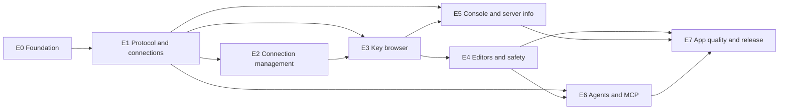

# Keel stories and delivery plan

This folder breaks the [Keel specifications](../README.md) into implementable stories. Each story file has the user story, scope, the spec sections it implements, dependencies, a size, **acceptance criteria** and the **unit tests** to write (XCTest class and test names). Requirement IDs (`FR-`, `NFR-`, `API-`, `INT-`, `MAC-`, `DS-`) link back to the contract; when a story changes behavior, the spec page changes first.

## How to use these stories

- Work stories in sprint order; a story starts only when everything in **Depends on** is done.
- Write the listed unit tests with the code (test names are the contract; add more as needed, never fewer).
- Check an acceptance box only when it was actually observed. Manual checks that can't be run yet (VoiceOver, notarization on a clean Mac, Intel hardware) stay unchecked and are noted as **pending**.
- Sizes are story points (1, 2, 3, 5, 8). Planned velocity: about 30 points per two-week sprint for one developer working with Claude Code.

## Epics

| Epic | Stories | Points | Milestone ([01 Overview](../01-overview.md#milestones)) |
| --- | --- | --- | --- |
| E0 Foundation | [KEEL-001](KEEL-001-package-scaffold-toolchain-and-ci.md), [KEEL-002](KEEL-002-vendor-trellis-shared-code.md), [KEEL-003](KEEL-003-owner-only-versioned-persistence.md) | 11 | 1 Protocol feasibility |
| E1 Protocol and connections | [KEEL-004](KEEL-004-resp2-resp3-streaming-codec.md), [KEEL-005](KEEL-005-redisconnection-actor-over-network-framework.md), [KEEL-006](KEEL-006-handshake-authentication-and-error-categories.md), [KEEL-007](KEEL-007-tls-with-custom-ca-client-identity-and-skip-verify.md), [KEEL-008](KEEL-008-ca-file-change-detection.md), [KEEL-009](KEEL-009-ssh-tunnel-manager.md), [KEEL-010](KEEL-010-askpass-broker-and-ssh-prompt-relay.md), [KEEL-011](KEEL-011-server-detection-capability-probes-and-minimum-version.md), [KEEL-012](KEEL-012-command-catalog.md), [KEEL-013](KEEL-013-safety-policy-and-single-data-path.md) | 55 | 1 Protocol feasibility |
| E2 Connection management | [KEEL-014](KEEL-014-connection-profiles-and-keychain-secrets.md), [KEEL-015](KEEL-015-connection-url-parsing-and-paste.md), [KEEL-016](KEEL-016-new-connection-sheet-and-test-connection.md), [KEEL-017](KEEL-017-sidebar-of-connections.md), [KEEL-018](KEEL-018-ssh-hosts-library.md), [KEEL-019](KEEL-019-import-and-export-profiles.md) | 23 | 2 Browse |
| E3 Key browser | [KEEL-020](KEEL-020-scan-key-index.md), [KEEL-021](KEEL-021-namespace-tree-and-binary-safe-names.md), [KEEL-022](KEEL-022-virtualized-key-list-tree-and-flat.md), [KEEL-023](KEEL-023-key-filters.md), [KEEL-024](KEEL-024-row-metadata-types-ttls-and-sizes.md), [KEEL-025](KEEL-025-database-switcher-dbsize-and-refresh.md), [KEEL-026](KEEL-026-windows-connection-tabs-and-modes.md) | 39 | 2 Browse |
| E4 Editors and safety | [KEEL-027](KEEL-027-editor-shell-save-bar-and-conflicts.md), [KEEL-028](KEEL-028-value-viewers-text-json-hex-raw.md), [KEEL-029](KEEL-029-string-editor.md), [KEEL-030](KEEL-030-hash-editor.md), [KEEL-031](KEEL-031-list-editor.md), [KEEL-032](KEEL-032-set-editor.md), [KEEL-033](KEEL-033-sorted-set-editor.md), [KEEL-034](KEEL-034-stream-viewer-and-add-entry.md), [KEEL-035](KEEL-035-key-actions-rename-ttl-delete-export.md), [KEEL-036](KEEL-036-new-key-sheet.md), [KEEL-037](KEEL-037-read-only-mode-and-production-chrome.md), [KEEL-038](KEEL-038-typed-confirmations-and-multi-key-delete.md), [KEEL-039](KEEL-039-bulk-delete-by-pattern.md) | 50 | 3 Edit |
| E5 Console and server info | [KEEL-040](KEEL-040-console-parser-and-redis-cli-formatter.md), [KEEL-041](KEEL-041-console-view-history-completion-streaming-masking.md), [KEEL-042](KEEL-042-server-info-overview.md) | 18 | 4 Console and Info |
| E6 Agents and MCP | [KEEL-043](KEEL-043-grants-tokens-and-authorization-policy.md), [KEEL-044](KEEL-044-agent-tool-catalog-over-the-data-path.md), [KEEL-045](KEEL-045-mcp-streamable-http-server.md), [KEEL-046](KEEL-046-approvals-for-destructive-agent-calls.md), [KEEL-047](KEEL-047-agents-settings-activity-and-pause.md) | 26 | 5 Agents |
| E7 App quality and release | [KEEL-048](KEEL-048-command-palette-and-rebindable-shortcuts.md), [KEEL-049](KEEL-049-design-tokens-themes-and-bundled-fonts.md), [KEEL-050](KEEL-050-accessibility-pass.md), [KEEL-051](KEEL-051-privacy-and-logging-guardrails.md), [KEEL-052](KEEL-052-performance-benchmarks.md), [KEEL-053](KEEL-053-integration-test-matrix.md), [KEEL-054](KEEL-054-settings-window.md), [KEEL-055](KEEL-055-welcome-screen-and-data-removal.md), [KEEL-056](KEEL-056-app-icon-asset-catalog.md), [KEEL-057](KEEL-057-packaging-signing-notarization-and-sparkle-updates.md) | 43 | 6 Release qualification |

**Total:** 57 stories, 265 points.

## Sprint plan

Two-week sprints. Each sprint ends with format, lint, build, tests green, an independent review and a short demo against the design canvas.

| Sprint | Goal | Stories | Points | Exit criteria |
| --- | --- | --- | --- | --- |
| S1 | Foundation and protocol core | [KEEL-001](KEEL-001-package-scaffold-toolchain-and-ci.md), [KEEL-002](KEEL-002-vendor-trellis-shared-code.md), [KEEL-003](KEEL-003-owner-only-versioned-persistence.md), [KEEL-004](KEEL-004-resp2-resp3-streaming-codec.md), [KEEL-005](KEEL-005-redisconnection-actor-over-network-framework.md), [KEEL-012](KEEL-012-command-catalog.md) | 27 | A test connects to a local Redis, pipelines commands and classifies them; state files are atomic and owner-only. |
| S2 | Secure connections and the data path | [KEEL-006](KEEL-006-handshake-authentication-and-error-categories.md), [KEEL-007](KEEL-007-tls-with-custom-ca-client-identity-and-skip-verify.md), [KEEL-008](KEEL-008-ca-file-change-detection.md), [KEEL-011](KEEL-011-server-detection-capability-probes-and-minimum-version.md), [KEEL-013](KEEL-013-safety-policy-and-single-data-path.md), [KEEL-014](KEEL-014-connection-profiles-and-keychain-secrets.md) | 31 | TLS and ACL fixtures connect with categorized errors; read-only blocks every write path; profiles persist with Keychain secrets. |
| S3 | Connection management and look | [KEEL-009](KEEL-009-ssh-tunnel-manager.md), [KEEL-010](KEEL-010-askpass-broker-and-ssh-prompt-relay.md), [KEEL-015](KEEL-015-connection-url-parsing-and-paste.md), [KEEL-016](KEEL-016-new-connection-sheet-and-test-connection.md), [KEEL-017](KEEL-017-sidebar-of-connections.md), [KEEL-018](KEEL-018-ssh-hosts-library.md), [KEEL-049](KEEL-049-design-tokens-themes-and-bundled-fonts.md) | 33 | A profile through an SSH bastion works end to end from the New Connection sheet; sidebar and theme tokens match the design. |
| S4 | Key browser | [KEEL-020](KEEL-020-scan-key-index.md), [KEEL-021](KEEL-021-namespace-tree-and-binary-safe-names.md), [KEEL-022](KEEL-022-virtualized-key-list-tree-and-flat.md), [KEEL-025](KEEL-025-database-switcher-dbsize-and-refresh.md), [KEEL-026](KEEL-026-windows-connection-tabs-and-modes.md) | 31 | 1M keys browse smoothly in tree and flat views; databases switch; windows and tabs restore. |
| S5 | Editing core | [KEEL-024](KEEL-024-row-metadata-types-ttls-and-sizes.md), [KEEL-027](KEEL-027-editor-shell-save-bar-and-conflicts.md), [KEEL-028](KEEL-028-value-viewers-text-json-hex-raw.md), [KEEL-029](KEEL-029-string-editor.md), [KEEL-030](KEEL-030-hash-editor.md), [KEEL-031](KEEL-031-list-editor.md), [KEEL-037](KEEL-037-read-only-mode-and-production-chrome.md) | 31 | Rows show badges and TTLs; strings, hashes and lists edit safely with conflicts detected; viewers switch formats; production chrome shows. |
| S6 | Editing complete and safety | [KEEL-023](KEEL-023-key-filters.md), [KEEL-032](KEEL-032-set-editor.md), [KEEL-033](KEEL-033-sorted-set-editor.md), [KEEL-034](KEEL-034-stream-viewer-and-add-entry.md), [KEEL-035](KEEL-035-key-actions-rename-ttl-delete-export.md), [KEEL-036](KEEL-036-new-key-sheet.md), [KEEL-038](KEEL-038-typed-confirmations-and-multi-key-delete.md), [KEEL-039](KEEL-039-bulk-delete-by-pattern.md) | 27 | All six types edit; filters and key actions work; bulk delete of 2M keys runs with progress and cancel; destructive actions need typed confirmation. |
| S7 | Console, info and agent core | [KEEL-040](KEEL-040-console-parser-and-redis-cli-formatter.md), [KEEL-041](KEEL-041-console-view-history-completion-streaming-masking.md), [KEEL-042](KEEL-042-server-info-overview.md), [KEEL-043](KEEL-043-grants-tokens-and-authorization-policy.md), [KEEL-044](KEEL-044-agent-tool-catalog-over-the-data-path.md) | 31 | Console matches redis-cli golden output; Info overview works; agent tools run through the data path in tests. |
| S8 | MCP and app basics | [KEEL-019](KEEL-019-import-and-export-profiles.md), [KEEL-045](KEEL-045-mcp-streamable-http-server.md), [KEEL-046](KEEL-046-approvals-for-destructive-agent-calls.md), [KEEL-047](KEEL-047-agents-settings-activity-and-pause.md), [KEEL-048](KEEL-048-command-palette-and-rebindable-shortcuts.md), [KEEL-054](KEEL-054-settings-window.md), [KEEL-055](KEEL-055-welcome-screen-and-data-removal.md) | 26 | Claude Code connects over MCP, scopes and approvals work; palette, shortcuts, settings and profile import/export are complete. |
| S9 | Quality | [KEEL-050](KEEL-050-accessibility-pass.md), [KEEL-051](KEEL-051-privacy-and-logging-guardrails.md), [KEEL-052](KEEL-052-performance-benchmarks.md), [KEEL-053](KEEL-053-integration-test-matrix.md), [KEEL-056](KEEL-056-app-icon-asset-catalog.md) | 20 | Accessibility audit clean, privacy guardrails verified, NFR-PF targets measured, integration matrix green, icon assets built. |
| S10 | Release | [KEEL-057](KEEL-057-packaging-signing-notarization-and-sparkle-updates.md) | 8 | Signed, notarized Universal DMG with working Sparkle update; release verification matrix recorded. |

## Story index

| Story | Title | Epic | Sprint | Points | Depends on |
| --- | --- | --- | --- | --- | --- |
| [KEEL-001](KEEL-001-package-scaffold-toolchain-and-ci.md) | Package scaffold, toolchain and CI | E0 | S1 | 3 | — |
| [KEEL-002](KEEL-002-vendor-trellis-shared-code.md) | Vendor Trellis shared code | E0 | S1 | 3 | KEEL-001 |
| [KEEL-003](KEEL-003-owner-only-versioned-persistence.md) | Owner-only versioned persistence | E0 | S1 | 5 | KEEL-002 |
| [KEEL-004](KEEL-004-resp2-resp3-streaming-codec.md) | RESP2/RESP3 streaming codec | E1 | S1 | 5 | KEEL-001 |
| [KEEL-005](KEEL-005-redisconnection-actor-over-network-framework.md) | RedisConnection actor over Network.framework | E1 | S1 | 8 | KEEL-004 |
| [KEEL-006](KEEL-006-handshake-authentication-and-error-categories.md) | Handshake, authentication and error categories | E1 | S2 | 5 | KEEL-005 |
| [KEEL-007](KEEL-007-tls-with-custom-ca-client-identity-and-skip-verify.md) | TLS with custom CA, client identity and skip-verify | E1 | S2 | 8 | KEEL-005 |
| [KEEL-008](KEEL-008-ca-file-change-detection.md) | CA file change detection | E1 | S2 | 2 | KEEL-007, KEEL-003 |
| [KEEL-009](KEEL-009-ssh-tunnel-manager.md) | SSH tunnel manager | E1 | S3 | 8 | KEEL-005, KEEL-002 |
| [KEEL-010](KEEL-010-askpass-broker-and-ssh-prompt-relay.md) | Askpass broker and SSH prompt relay | E1 | S3 | 5 | KEEL-009 |
| [KEEL-011](KEEL-011-server-detection-capability-probes-and-minimum-version.md) | Server detection, capability probes and minimum version | E1 | S2 | 3 | KEEL-006 |
| [KEEL-012](KEEL-012-command-catalog.md) | Command catalog | E1 | S1 | 3 | KEEL-004 |
| [KEEL-013](KEEL-013-safety-policy-and-single-data-path.md) | Safety policy and single data path | E1 | S2 | 8 | KEEL-012, KEEL-006 |
| [KEEL-014](KEEL-014-connection-profiles-and-keychain-secrets.md) | Connection profiles and Keychain secrets | E2 | S2 | 5 | KEEL-003 |
| [KEEL-015](KEEL-015-connection-url-parsing-and-paste.md) | Connection URL parsing and paste | E2 | S3 | 2 | KEEL-014 |
| [KEEL-016](KEEL-016-new-connection-sheet-and-test-connection.md) | New Connection sheet and Test Connection | E2 | S3 | 5 | KEEL-015, KEEL-007, KEEL-009, KEEL-011 |
| [KEEL-017](KEEL-017-sidebar-of-connections.md) | Sidebar of connections | E2 | S3 | 5 | KEEL-014 |
| [KEEL-018](KEEL-018-ssh-hosts-library.md) | SSH hosts library | E2 | S3 | 3 | KEEL-010, KEEL-002 |
| [KEEL-019](KEEL-019-import-and-export-profiles.md) | Import and export profiles | E2 | S8 | 3 | KEEL-014 |
| [KEEL-020](KEEL-020-scan-key-index.md) | SCAN key index | E3 | S4 | 8 | KEEL-013 |
| [KEEL-021](KEEL-021-namespace-tree-and-binary-safe-names.md) | Namespace tree and binary-safe names | E3 | S4 | 5 | KEEL-020 |
| [KEEL-022](KEEL-022-virtualized-key-list-tree-and-flat.md) | Virtualized key list (tree and flat) | E3 | S4 | 8 | KEEL-021 |
| [KEEL-023](KEEL-023-key-filters.md) | Key filters | E3 | S6 | 3 | KEEL-020 |
| [KEEL-024](KEEL-024-row-metadata-types-ttls-and-sizes.md) | Row metadata: types, TTLs and sizes | E3 | S5 | 5 | KEEL-022 |
| [KEEL-025](KEEL-025-database-switcher-dbsize-and-refresh.md) | Database switcher, DBSIZE and refresh | E3 | S4 | 2 | KEEL-020 |
| [KEEL-026](KEEL-026-windows-connection-tabs-and-modes.md) | Windows, connection tabs and modes | E3 | S4 | 8 | KEEL-017, KEEL-003 |
| [KEEL-027](KEEL-027-editor-shell-save-bar-and-conflicts.md) | Editor shell, save bar and conflicts | E4 | S5 | 5 | KEEL-013, KEEL-026 |
| [KEEL-028](KEEL-028-value-viewers-text-json-hex-raw.md) | Value viewers: Text, JSON, Hex, Raw | E4 | S5 | 5 | KEEL-027 |
| [KEEL-029](KEEL-029-string-editor.md) | String editor | E4 | S5 | 3 | KEEL-028 |
| [KEEL-030](KEEL-030-hash-editor.md) | Hash editor | E4 | S5 | 5 | KEEL-028 |
| [KEEL-031](KEEL-031-list-editor.md) | List editor | E4 | S5 | 5 | KEEL-028 |
| [KEEL-032](KEEL-032-set-editor.md) | Set editor | E4 | S6 | 2 | KEEL-028 |
| [KEEL-033](KEEL-033-sorted-set-editor.md) | Sorted set editor | E4 | S6 | 5 | KEEL-028, KEEL-011 |
| [KEEL-034](KEEL-034-stream-viewer-and-add-entry.md) | Stream viewer and add entry | E4 | S6 | 3 | KEEL-028, KEEL-011 |
| [KEEL-035](KEEL-035-key-actions-rename-ttl-delete-export.md) | Key actions: rename, TTL, delete, export | E4 | S6 | 3 | KEEL-027 |
| [KEEL-036](KEEL-036-new-key-sheet.md) | New key sheet | E4 | S6 | 3 | KEEL-029, KEEL-030, KEEL-031, KEEL-032, KEEL-033, KEEL-034 |
| [KEEL-037](KEEL-037-read-only-mode-and-production-chrome.md) | Read-only mode and production chrome | E4 | S5 | 3 | KEEL-013, KEEL-026 |
| [KEEL-038](KEEL-038-typed-confirmations-and-multi-key-delete.md) | Typed confirmations and multi-key delete | E4 | S6 | 3 | KEEL-013 |
| [KEEL-039](KEEL-039-bulk-delete-by-pattern.md) | Bulk delete by pattern | E4 | S6 | 5 | KEEL-038, KEEL-020 |
| [KEEL-040](KEEL-040-console-parser-and-redis-cli-formatter.md) | Console parser and redis-cli formatter | E5 | S7 | 5 | KEEL-004 |
| [KEEL-041](KEEL-041-console-view-history-completion-streaming-masking.md) | Console view: history, completion, streaming, masking | E5 | S7 | 8 | KEEL-040, KEEL-013, KEEL-012 |
| [KEEL-042](KEEL-042-server-info-overview.md) | Server info overview | E5 | S7 | 5 | KEEL-011, KEEL-026 |
| [KEEL-043](KEEL-043-grants-tokens-and-authorization-policy.md) | Grants, tokens and authorization policy | E6 | S7 | 5 | KEEL-003, KEEL-002 |
| [KEEL-044](KEEL-044-agent-tool-catalog-over-the-data-path.md) | Agent tool catalog over the data path | E6 | S7 | 8 | KEEL-043, KEEL-013 |
| [KEEL-045](KEEL-045-mcp-streamable-http-server.md) | MCP Streamable HTTP server | E6 | S8 | 5 | KEEL-044, KEEL-002 |
| [KEEL-046](KEEL-046-approvals-for-destructive-agent-calls.md) | Approvals for destructive agent calls | E6 | S8 | 5 | KEEL-044, KEEL-038 |
| [KEEL-047](KEEL-047-agents-settings-activity-and-pause.md) | Agents settings, activity and pause | E6 | S8 | 3 | KEEL-045, KEEL-046 |
| [KEEL-048](KEEL-048-command-palette-and-rebindable-shortcuts.md) | Command palette and rebindable shortcuts | E7 | S8 | 5 | KEEL-026, KEEL-002 |
| [KEEL-049](KEEL-049-design-tokens-themes-and-bundled-fonts.md) | Design tokens, themes and bundled fonts | E7 | S3 | 5 | KEEL-001 |
| [KEEL-050](KEEL-050-accessibility-pass.md) | Accessibility pass | E7 | S9 | 5 | KEEL-047, KEEL-042, KEEL-041 |
| [KEEL-051](KEEL-051-privacy-and-logging-guardrails.md) | Privacy and logging guardrails | E7 | S9 | 3 | KEEL-041, KEEL-044 |
| [KEEL-052](KEEL-052-performance-benchmarks.md) | Performance benchmarks | E7 | S9 | 5 | KEEL-022, KEEL-024, KEEL-028 |
| [KEEL-053](KEEL-053-integration-test-matrix.md) | Integration test matrix | E7 | S9 | 5 | KEEL-011, KEEL-009, KEEL-007 |
| [KEEL-054](KEEL-054-settings-window.md) | Settings window | E7 | S8 | 3 | KEEL-049 |
| [KEEL-055](KEEL-055-welcome-screen-and-data-removal.md) | Welcome screen and data removal | E7 | S8 | 2 | KEEL-016, KEEL-014 |
| [KEEL-056](KEEL-056-app-icon-asset-catalog.md) | App icon asset catalog | E7 | S9 | 2 | KEEL-001 |
| [KEEL-057](KEEL-057-packaging-signing-notarization-and-sparkle-updates.md) | Packaging, signing, notarization and Sparkle updates | E7 | S10 | 8 | KEEL-056, KEEL-053 |

## Dependency overview

Critical path: KEEL-004 → KEEL-005 → KEEL-006 → KEEL-013 → KEEL-020 → KEEL-021 → KEEL-022 → KEEL-027 → KEEL-028 → editors → KEEL-038 → KEEL-046 → KEEL-047 → KEEL-050 → KEEL-057.

## Definition of done

A story is done when all of these hold:

1. The spec pages it touches are updated first (new requirement IDs get acceptance checks).
2. Code and the listed unit tests are in; tests assert observable behavior and failure safety (previous state kept on error).
3. `swift format lint --strict -r Sources Tests ThirdParty` prints nothing; `swift build` has zero warnings; `swift test` passes.
4. Integration checks listed in the story pass against containers (never a user's servers).
5. UI stories are reviewed against the design canvas ([08 Design](../08-design.md)) in light and dark, with VoiceOver labels and keyboard operation.
6. No secrets, values, key names or console output are logged or persisted beyond what the specs allow.
7. An independent review agent checked correctness, security, data loss, races and test gaps; crucial findings fixed.
8. `CHANGELOG.md` updated for user-visible changes; acceptance boxes checked only when observed; pending manual checks listed.

## Testing conventions

- XCTest, one class per area, descriptive names (`testBlockedCommandSendsNothing`). Review-driven extras go in `*ReviewTests.swift`.
- Inject time, filesystem, Keychain, processes and transports (`RedisConnection` takes a `Transport`; `TunnelManager` takes a process launcher).
- Protocol behavior is tested against in-memory fake servers first and real containers in `KeelIntegrationTests`.
- Golden files live in `Tests/Fixtures/` (INFO outputs per server, redis-cli outputs, RESP frames).
- Performance tests use `measure` with fixed baselines; the benchmark script records evidence for release.

## Risks

| Risk | Impact | Mitigation | Story |
| --- | --- | --- | --- |
| Network.framework TLS with custom anchors and client identities | Blocks managed and secured servers | Spike early in S2 with fixtures; fall back to `SecTrust` evaluation in the verify block | KEEL-007 |
| ssh prompts without a terminal | Tunnels fail on first host-key prompt | Askpass relay design proven in S3 with an sshd container | KEEL-010 |
| 1M-key smoothness in AppKit lists | Core promise of the browser | Compact arena index, lazy display strings, benchmark from S4 | KEEL-020–KEEL-022, KEEL-052 |
| Server variance (Dragonfly, managed services) | Features fail unexpectedly | Capability probes and "unavailable" states; integration matrix | KEEL-011, KEEL-053 |
| Agents misusing data access | Data loss or leaks | Single data path, read-only defaults for agent-created profiles, approvals, untrusted-data notice | KEEL-013, KEEL-044, KEEL-046 |
| Notarization and Sparkle setup | Release delay | Dry-run packaging from S9 with ad-hoc signing; pinned actions | KEEL-057 |
